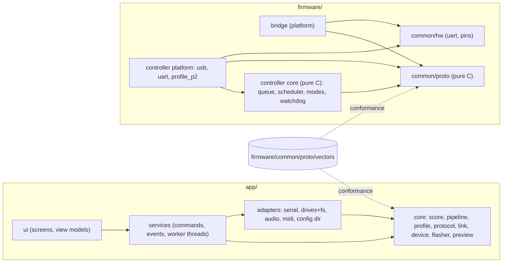
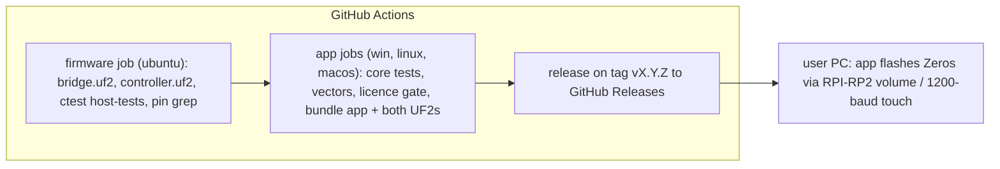
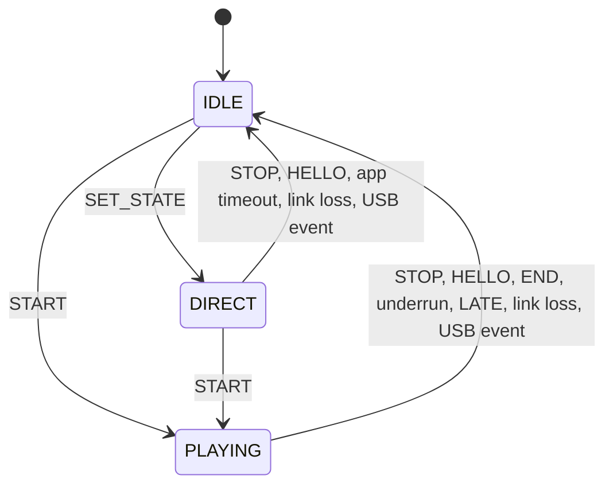

# Architecture Spine — bonooru

## Design Paradigm

**Compile ahead, play on the device** (ADR-003): the app turns a score into a complete timeline with absolute times. The controller board is the only clock, and nothing on the PC side runs in real time.

- **Firmware: layered, with a hardware-free core.** `common/proto` is a pure C99 codec. The controller's queue, scheduler, mode logic and watchdog logic are plain C with no pico-sdk includes, so they build and run on a PC. pico-sdk and TinyUSB are used only in thin platform files.
- **App: hexagonal (functional core, imperative shell).** The core has no GUI, no threads and no I/O. The link session is **sans-IO**: it takes bytes and a clock and returns bytes and typed events. Adapters (serial, drives and files, audio, MIDI, config dir) implement ports defined by the core. The UI talks only to an application-service layer.



Arrows mean "may depend on". Nothing depends on `ui`, `core` depends on nothing outside itself, and no firmware core file includes pico-sdk.

## Invariants & Rules

### AD-1 — Firmware toolchain pin [ADOPTED in part: ADR-004]

- **Binds:** firmware/, CI
- **Prevents:** the two boards being built against different SDK, TinyUSB or picotool revisions.
- **Rule:**
  - pico-sdk is a git submodule at `firmware/external/pico-sdk`, pinned to tag `2.3.1`. Only its `lib/tinyusb` sub-submodule is initialised (TinyUSB 0.18.0), and `PICO_TINYUSB_PATH` is never overridden.
  - picotool `2.3.1` is installed and pinned in CI; it is never fetched at build time.
  - `PICO_BOARD=waveshare_rp2040_zero`.
  - The Arm GNU Toolchain version is pinned in CI.
  - Each SDK upgrade is its own PR, and that PR rebuilds both UF2s.

### AD-2 — One CMake project, a pure protocol library, two targets [ADOPTED: repo layout]

- **Binds:** firmware/common, firmware/bridge, firmware/controller
- **Prevents:** a separate copy of the codec or the wire constants for each board, and codec code that cannot be tested on a PC.
- **Rule:**
  - `firmware/CMakeLists.txt` defines:
    - `ocb_proto` (pure C99): COBS, CRC-16/CCITT-FALSE, frame types, message structs, canonical state, `NEUTRAL`, `PROTO_VERSION`, `OCB_MAX_ENCODED_FRAME`, link timing constants and the baud rate;
    - `ocb_hw`: UART helpers and `pins.h`, on pico-sdk;
    - the executables `bridge` and `controller`.
  - Wire constants exist only in `ocb_proto`.
  - Presets: `fw-release`, `fw-debug` and `host-tests`. `host-tests` uses the native compiler and ctest, without pico-sdk.

### AD-3 — Frame type ranges and ownership

- **Binds:** link protocol, bridge, controller, app link
- **Prevents:** the bridge and the app using the same message types, and heartbeats reaching the app or being ACKed.
- **Rule:**

  | Range | Direction | Rules |
  |---|---|---|
  | `0x01–0x3F` | app→controller | |
  | `0x40–0x7F` | bridge→controller | link-local: never forwarded to the app, never ACKed, outside the app `seq` space |
  | `0x80–0xFF` | controller→app | |

  A receiver counts and drops empty frames and types outside its range. Receive order: COBS decode, then a length/`len` consistency check (a failure is treated as a CRC error), then CRC, then type range, then seq, then semantics.

### AD-4 — Bridge heartbeat and framing

- **Binds:** bridge, controller watchdog, NFR-05, CAP-5
- **Prevents:**
  - line noise feeding the watchdog;
  - heartbeat bytes landing inside an app frame;
  - host stalls, a prefill burst or a PC that stops reading starving the heartbeat, which would cause false trips during playback.
- **Rule:**
  - **Heartbeat frame.** `HEARTBEAT` (type `0x40`) is a COBS+CRC frame. It carries its own rolling seq and the body `bridge_fw_ver[3], flags` (bit0 = CDC DTR asserted). This body prefix is frozen.
  - **Timing.** A hardware alarm drives the heartbeat every 20 ms, whatever the USB state. Wire spacing is at most 27 ms.
  - **PC→UART, store-and-forward.** The bridge only scans for `0x00` delimiters; it never decodes. Whole frames are written to the UART: at most one app frame in flight plus one queued. A heartbeat that is due goes out at the next frame boundary, ahead of queued app frames. The rest of the buffering stays in CDC, so USB backpressure is the flow control.
  - **Discarded input.** A run of more than `OCB_MAX_ENCODED_FRAME` bytes without a delimiter is dropped and counted. A partial frame is discarded when DTR falls or CDC unmounts.
  - **UART→PC, best effort.** Bytes are copied as they come and dropped (and counted) when the CDC IN FIFO is full.
  - No bridge code path may block.

### AD-5 — Controller link watchdog [ADOPTED: watchdog decision 2026-11-19]

- **Binds:** controller, NFR-05, A.3, W.1, W.2
- **Prevents:** an input staying pressed on the console after link loss, and false trips caused by host jitter.
- **Rule:**
  - **Link loss.** If no valid `HEARTBEAT` arrives within `OCB_LINK_TIMEOUT_MS` (≤ 100, default 80), or the UART reports a break, the controller aborts to IDLE (AD-8) and sends `EVENT LINK_LOST`.
  - **Break detection.** UART RX is IRQ-driven and reads the data register's error bits, so the break flag is seen. 8-bit DMA, which drops it, is not used.
  - **App timeout.** `app_timeout_ms` (firmware constant, default 1000 until W.1) applies **only in DIRECT mode**, as does a DTR falling edge seen in `HEARTBEAT.flags`. Either one aborts to IDLE.
  - **No app timeout in PLAYING.** The underrun rule (AD-8) covers a dead app.
  - **Gating.** While the link is down, `START` and `SET_STATE` get `NAK NO_LINK`.

### AD-6 — Reliable, ordered app frames (go-back-N, credits)

- **Binds:** controller decoder, app link session
- **Prevents:** duplicated or missing `QUEUE_EVENT`s, NAK storms, livelock on rejected frames, and queue overrun.
- **Rule:**
  - **Acceptance.** `seq` is a u8 that wraps. The controller accepts only `seq == expected`.
  - **Stale frames.** A stale seq in `[expected−64, expected−1]` gets a cumulative `ACK(expected−1)` and has no effect. A duplicate of `expected−1` gets the cached response it got the first time.
  - **NAK body:** `reason, expected, got`.
  - **Transport NAKs** (`CRC`, `SEQ`, `FULL`) never advance `expected`. The controller sends at most one per value of `expected`, and the app rewinds only on a NAK whose `expected` is ahead of its last rewind point.
  - **Semantic NAKs** (`VERSION`, `BUSY`, `ORDER`, `BAD_STATE`, `UNKNOWN_TYPE`, `NO_LINK`, `NOT_READY`, `ABORTED`) advance `expected` and the frame has no effect. After a semantic NAK on `QUEUE_EVENT` or `START`, the app abandons the piece and sends `STOP`.
  - **Sync points.** `HELLO` and `STOP` are accepted with any seq, in any state, and set `expected = seq+1` (see AD-8).
  - **ACK.** ACKs are cumulative. The app resends from its oldest unACKed frame after `OCB_ACK_TIMEOUT_MS` (50).
  - **Credits.** `credit = STATUS.free − (QUEUE_EVENTs sent after STATUS.last_seq)`. The app sends at most `min(credit, 64 − unacked)` frames.

### AD-7 — Protocol versioning and session start

- **Binds:** common/proto, app link, CAP-6, FR-10
- **Prevents:**
  - an app and firmware from different tags silently misreading each other;
  - a mismatch that cannot be detected because INFO changed shape;
  - a restarted app inheriting a running piece.
- **Rule:**
  - **Version.** `PROTO_VERSION` is a u8, and only an exact match is accepted. Any change that breaks wire compatibility bumps it.
  - **Frozen forever:**
    - the frame layout and the COBS and CRC rules;
    - type codes `0x01` (HELLO) and `0x81` (INFO);
    - the HELLO body (`proto_ver:u8`);
    - byte 0 of INFO (`proto_ver`);
    - the HEARTBEAT body prefix.
  - **Opening a session.** On open, the app asserts DTR and writes one `0x00`. It then sends `HELLO` and nothing else until `INFO` arrives, resending `HELLO` every 100 ms.
  - **HELLO.** HELLO has STOP semantics (AD-8) and is always answered with INFO. Until a matching HELLO arrives, every other app frame except STOP gets `NAK VERSION`.
  - **INFO v1:** `proto_ver u8, fw_ver[3], bridge_ver[3]` (from the last HEARTBEAT, zeros if none), `hid_profile u8, queue_cap u16, app_timeout_ms u16, report_period_us u16` (the measured median IN interval, 0 if unknown).
  - **Runtime values.** The app takes these values from INFO and never hard-codes them. In DIRECT mode it sends `PING` whenever it has been idle for `app_timeout_ms/4`.
  - **`NAK VERSION` in mid-session.** The app treats it as a lost session (the controller rebooted) and sends HELLO again.

### AD-8 — Controller modes, abort latch, end of piece

- **Binds:** controller core, app streamer, CAP-4, CAP-8, FR-07
- **Prevents:**
  - the gamepad and the timeline fighting over the report;
  - the tail of an aborted piece replaying;
  - a stuck note at the end of a piece or on an underrun;
  - confusion between "the piece ended" and "the app died".
- **Rule:** core 1 owns the modes IDLE, DIRECT and PLAYING.

  | Frame | IDLE | DIRECT | PLAYING |
  |---|---|---|---|
  | `SET_STATE` | → DIRECT | apply | NAK `BUSY` |
  | `QUEUE_EVENT` | enqueue (prefill) | enqueue (prefill) | enqueue |
  | `START lead_us` | → PLAYING, t0 = now + lead | real-time state → NEUTRAL, → PLAYING | NAK `BUSY` |
  | `STOP` / `HELLO` | NEUTRAL, clear queue, clear `aborted` | same, → IDLE | same, → IDLE |

  - **Entering IDLE** always publishes `NEUTRAL`, clears the queue and resets the ordering baseline.
  - **Abort latch.** Any transition to IDLE that the app did not request sets `aborted`. The causes are: END applied, underrun, `LATE`, link loss, app timeout, USB suspend/unmount/bus reset in any mode, and a core stall. While `aborted` is set, `QUEUE_EVENT`, `START` and `SET_STATE` get `NAK ABORTED`. Only `STOP` or `HELLO` clears it.
  - **Ordering.** `t_us` must be strictly increasing (else `NAK ORDER`) and below 2^31.
  - **End of piece.** The last event is `NEUTRAL` with `flags` bit0 = END; any other state carrying END gets `NAK BAD_STATE`. Applying it sends `EVENT PLAYBACK_DONE`. The other `flags` bits are reserved and must be 0.
  - **Underrun** is judged when an event is applied. If a non-END event is applied and the queue is then empty, the controller publishes NEUTRAL in the same loop pass and sends `EVENT UNDERRUN`.
  - **Late head event.** If the head event is overdue by more than one report period, the controller aborts with `EVENT LATE` and never fires a backlog.
  - **Not ready.** `START` and `SET_STATE` get `NAK NOT_READY` while the profile's `ready()` is false. The same predicate drives `STATUS.flags.console_ready` (AD-19).

### AD-9 — Queue-mode input allow-list (C6) [ADOPTED: risk register C6]

- **Binds:** controller core
- **Prevents:** a timeline pressing a system or menu input because of a bug or a changed mapping.
- **Rule:**
  - In PLAYING, every applied state is masked by a compile-time allow-list: buttons L, R, A, X, Y, the hat and the left stick.
  - Every other button is cleared and the right stick is centred.
  - DIRECT mode is not masked.
  - Adding an input to the list takes a firmware change, for example if M2 (U11) finds another ocarina input.

### AD-10 — Canonical controller state

- **Binds:** common/proto, controller profiles, app protocol, app profile/pipeline
- **Prevents:** two bit layouts for the same 8 bytes, and different definitions of neutral.
- **Rule:**
  - The 8-byte state uses the P1 button bit order: `bit0 Y, 1 B, 2 A, 3 X, 4 L, 5 R, 6 ZL, 7 ZR, 8 −, 9 +, 10 L3, 11 R3, 12 Home, 13 Capture`.
  - The hat uses 0–7, with 8 = neutral.
  - Sticks are centred at 0x80, and `ly 0x00` = up.
  - `NEUTRAL` is defined once in each codebase, and the vectors check that the definitions match.
  - Only the HID profile module turns the state into a USB report.

### AD-11 — Controller core split and liveness

- **Binds:** firmware/controller
- **Prevents:**
  - races on the current state or on UART TX;
  - USB work adding timing jitter;
  - a hung core leaving an input pressed.
- **Rule:**
  - **Core 0** runs the TinyUSB device task, the active profile and report sending. It is the only core that touches TinyUSB.
  - **Core 1** runs a non-blocking super-loop from RAM (`__not_in_flash_func`): UART, decode, modes, queue, the scheduler on the 1 MHz timer, and the watchdogs. Target loop period: < 50 µs.
  - **Current state.** Core 1 is the only writer, through a seqlock double buffer. The reader retries at most 3 times, then uses `NEUTRAL`.
  - **UART TX.** Core 1 is the only writer.
  - **Core 0 → core 1 traffic.** USB state goes through latched atomic flags, and debug logs through an SPSC ring that drops when full. Nothing ever blocks on a FIFO push.
  - **Liveness.** Core 0 feeds the hardware watchdog (≤ 100 ms) only while core 1's liveness counter is less than 20 ms old. Core 1 forces a watchdog reboot (USB detach releases all inputs) if core 0's report counter is more than 20 ms old.

### AD-12 — HID profile interface [ADOPTED: ADR-002]

- **Binds:** firmware/controller/profile_*
- **Prevents:** profile code reaching into the scheduler, and P1/P3 forcing changes to the protocol or the app.
- **Rule:**
  - Exactly one profile is linked per build (`OCB_PROFILE`, default `P2`).
  - Interface: descriptors, a control/OUT-report handler (the handshake), `build_report(const ocb_state*)`, `tick()` and `ready()`.
  - A profile reads only the published state.
  - The P2 profile refuses firmware-update subcommands (C7) and restarts its handshake after a bus reset. In debug builds only, it logs subcommands through the SPSC ring.
  - `INFO.hid_profile` holds the profile id.

### AD-13 — Bridge USB identity, discovery and BOOTSEL touch

- **Binds:** bridge, app device discovery, flasher, FR-08, FR-10, R8
- **Prevents:**
  - a discovery method that differs by OS (Windows does not report the USB product string through `serialport`);
  - a 1200-baud touch rebooting somebody else's board;
  - two `tud_cdc_line_coding_cb` definitions.
- **Rule:**
  - **USB descriptors.** VID:PID is the generic Raspberry Pi pair `2E8A:000A` (Q1, decided 2026-11-19 for now; an own PID can be requested later without changing the design). Because other Pico boards share it, the app sends the 1200-baud touch only to a port confirmed as our bridge (product string `Bonooru Bridge`, or an explicit pick by the user in the setup wizard when the OS doesn't report the string). The product string is `Bonooru Bridge`. The serial number is the flash unique ID.
  - **Discovery.** The app matches on VID:PID first. It then uses the product string as an extra filter where the OS reports it. It sends the `HELLO` probe only to ports that match VID:PID.
  - **1200-baud touch.** The app sends it only to a port that matches VID:PID. The bridge firmware uses pico-sdk `pico_usb_reset` with `PICO_ENABLE_USB_RESET_VIA_BAUD_RATE=1` and does not define `tud_cdc_line_coding_cb` itself.
  - **Version.** The bridge's version reaches the app only through `INFO.bridge_ver`.
  - **Update offer.** With no controller wired, the setup wizard always offers to reflash the bridge. If the protocol versions don't match, the update is required. If `fw_ver` or `bridge_ver` ≠ the app version, the update is recommended.

### AD-14 — Single source for versions and wire conformance

- **Binds:** firmware, app, CI, FR-10
- **Prevents:** the app and firmware codecs drifting apart, and version numbers that disagree.
- **Rule:**
  - **Repo version.** The repo version is the git tag `vX.Y.Z`, read through `git describe` (fallback `0.0.0-dev`) by the firmware CMake and the app build only.
  - **Test vectors.** `firmware/common/proto/vectors/` holds language-neutral vectors: one text file per area, one `name: hex` line each, and a `proto_version` header. They cover:
    - COBS and CRC;
    - every message;
    - a maximum-length frame, an empty frame, back-to-back frames, a leading delimiter, a bad CRC and an overlong run;
    - `NEUTRAL`.
  - **Checks.** The firmware host tests and the app core tests both run the vectors. CI checks that both codebases' `PROTO_VERSION` equals the header.
  - **Change order.** A wire change edits the vectors first. These ADs and the vectors take precedence over `docs/link-protocol.md`.
  - **Flashing.** The app flashes only the UF2s bundled at its own version.

### AD-15 — The timeline is the app↔device contract [ADOPTED: ADR-003, ADR-007]

- **Binds:** app pipeline, app streamer, CAP-1, CAP-2, CAP-3, CAP-4, CAP-9, CAP-11
- **Prevents:**
  - timing logic leaking into the streamer or the firmware;
  - tempo being applied in two places;
  - false underruns during long rests;
  - presses too short to register.
- **Rule:**
  - **Producer.** Only the core pipeline produces a `Timeline`. Each event has `t_us` (u32 from START, strictly increasing, < 2^31) and a full canonical state snapped to the profile's frame grid. The last event is `NEUTRAL|END`.
  - **Annotations.** Events can carry annotations for the UI and the export (note index, pitch, fingering). These are never sent.
  - **Outputs.** The pipeline also returns the range-fit report (FR-04) and official-song detection (R2), which raises a warning; no fingering avoids a song because the game matches by pitch (Spike 1.8, 2026-11-20).
  - **Minimum durations.** Validation rejects a min press or min gap below `2 × max(report_period_us, frame time)`.
  - **Export.** A timeline exports to CSV (`t_us`, pitch, fingering), which is the M7 ground truth.
  - **Tempo and countdown.** Tempo scale means recompiling. Countdown means the UI plus `START lead_us`. The firmware has no notion of tempo.
  - **Streamer.** The streamer prefills, sends `START`, and then sends whenever it has credit (greedy). It never edits, drops or reorders events.
  - **Live MIDI** (M10) uses `SET_STATE` in DIRECT mode, never the queue.

### AD-16 — App threading and device ownership

- **Binds:** app services, ui, adapters, CAP-7, CAP-8
- **Prevents:**
  - a frozen UI;
  - two owners of the serial port;
  - the flasher picking the wrong volume.
- **Rule:**
  - **Serial worker.** One serial worker thread owns the port and the link session.
  - **UI ↔ worker.** The UI and the worker communicate only by messages: commands in, events and immutable snapshots out. They share no mutable state.
  - **Worker commands.** Connect, disconnect, the 1200-baud touch and the verification after flashing are serial-worker commands.
  - **Flasher worker.** It never opens a serial port. It takes a snapshot of the mounted volumes before the touch or the BOOTSEL prompt, accepts exactly one new volume containing `INFO_UF2.TXT`, checks that the UF2 family is RP2040, copies the file and waits for the volume to disappear.
  - **Audio preview.** The core renders it into a buffer, and the audio adapter plays it.
  - The UI thread never blocks on I/O.

### AD-17 — Mapping profile ownership [ADOPTED: FR-06, R14]

- **Binds:** app core profile module, CAP-3, CAP-12
- **Prevents:** mapping or timing values in code, and several parsers with different defaults.
- **Rule:**
  - The profile is TOML with an integer `schema` field.
  - Only the core `profile` module loads, validates and migrates it; everyone else receives a validated `Profile`.
  - Bundled defaults, one per game version, ship read-only.
  - User copies, including calibration output, live in the OS config dir and override the bundled default with the same name and game version. A user copy that cannot be migrated is refused with a message.
  - App settings live in a separate file.

### AD-18 — App stack: Rust + egui/eframe (ADR-008, accepted 2026-11-20)

- **Binds:** app/
- **Prevents:** a second app stack, GUI types leaking into the core, and platform quirks found by the spike resurfacing in the real app.
- **Rule:**
  - The app is Rust + egui/eframe, a Cargo workspace in `app/`. Crates proven by `spikes/app-egui`: `eframe`/`egui` 0.37 (pinned exactly), `serialport`, `midly`, `rodio`. Full list, versions and packaging: `app-stack-options.md`.
  - The core/UI boundary is enforced mechanically: the core crate has no `egui`/`eframe` dependency. AD-15 to AD-17 and the module boundaries apply.
  - **Serial ports on macOS.** Each device appears as `/dev/cu.*` and `/dev/tty.*`; discovery shows and opens only `cu.*`.
  - **Audio output.** Opening the output device can fail transiently (e.g. Bluetooth profile switch). The UI shows a clear error with a Retry action, and the audio adapter re-opens the output when the default device changes; it never silently falls back to no sound.
  - **NFR-07 amended 2026-11-19 (Q2 resolved):** `serialport` is MPL-2.0, used unmodified. egui's default fonts are OFL-1.1 / Ubuntu-font-1.0; their licence texts ship with the app (AD-21), or the fonts are replaced.
  - **Linux build.** The Linux app ships on X11/XWayland: eframe is built without the `wayland` feature, because winit 0.30 does not deliver file drops on Wayland. File › Open… is always available, so drag-and-drop is never the only way to load a file.
  - **UI-internal state.** App-level undo/redo and the two-way sync between the text score and the note view live in the app (ui + core score editing) and have no protocol impact. The UI contract is the UX spines `DESIGN.md` and `EXPERIENCE.md` (`_bmad-output/planning-artifacts/ux-designs/ux-bonooru-2026-11-20/`).
  - **Rejected alternative:** Python 3.12 + PySide6 (bundle ~113 MB vs ~11 MB Rust binary; LGPL Qt + FFmpeg obligations; PyInstaller antivirus false positives).

### AD-19 — STATUS and controller→app reporting

- **Binds:** controller, app link and its link-status indicators, CAP-4, W.1, W.2
- **Prevents:**
  - the app's view of the mode drifting from the controller's when an EVENT is lost;
  - controller TX blocking or flooding;
  - the app learning the console state only by probing with `START`/`SET_STATE`, or inventing its own readiness rule.
- **Rule:**
  - **STATUS body:** `free u16, now_us u32` (µs since t0, 0 when IDLE or during the lead), `last_seq` (= `expected−1`), `mode`, `abort_count`, `last_event`, `flags u8`. Debug builds add counters: the maximum gap between app frames (W.1), watchdog trips and dropped bytes.
  - **STATUS flags.** bit0 `link_ok`, bit1 `console_ready`; bits 2–7 are reserved, written as 0 and ignored by the app. A new status bit takes a reserved bit and needs no `PROTO_VERSION` bump (AD-7).
  - **`console_ready`** is the profile's `ready()` when the STATUS is built, the same predicate that gates `NAK NOT_READY` (AD-8), which is still sent.
    - It becomes 1 when the console handshake completes (P2: the `0x80` handshake; P1: `SET_CONFIGURATION` and the first IN poll).
    - It returns to 0 on USB suspend, unmount or bus reset, and when no IN report has been taken for more than 100 ms (this covers "Pro Controller Wired Communication" being switched off without a bus event). The polling stall clears the flag only; it is not an abort cause.
    - Unplugging the controller ends STATUS altogether. With the bridge alone the app receives no STATUS, so it treats both the bridge↔controller and the controller↔Switch states as down.
  - **Timing.** STATUS goes out every 50 ms, plus after ACKs, coalesced to at most one per 10 ms.
  - **Mode in the app.** The app derives the mode from STATUS. EVENT is only a fast path.
  - **Controller TX.** Priority is EVENT > NAK > ACK > STATUS. On overflow the lowest priority is dropped; TX never blocks.
  - **Unknown values.** Unknown EVENT codes and NAK reasons are logged and are never fatal.

### AD-20 — Pins and back-powering (rule zero, C5) [AMENDED 2026-11-22: story 2.6 D25, applied by story 2.7]

- **Binds:** firmware/common/hw, bridge, controller
- **Prevents:** firmware driving anything but the UART link, and either board back-powering an unpowered peer (including the controller, powered by the Switch, feeding an unplugged bridge).
- **Rule:**
  - **Pins.** Firmware configures only GP0 (TX), GP1 (RX) and the onboard LED (GP16). These are defined in `ocb_hw/pins.h`, and a CI grep forbids other pin numbers. A debug toggle pin exists only in debug builds and is defined in the same file.
  - **TX release.** Both boards enable an internal pull-down on RX. The controller keeps TX high-Z until its RX has been idle-high for 1 ms (`OCB_LINK_TX_IDLE_HIGH_US`), and releases TX again on a break or on link loss, after the `EVENT LINK_LOST` has left. The bridge leads: while its RX does not show a live controller it drives TX idle-high in short probe pulses (about 5 ms every 500 ms, at most 1 % duty) and returns to high-Z in between; once its RX shows the controller (idle-high, or a valid frame) it keeps TX enabled, and after a break or link loss it returns to probing. A rule that made both boards wait for idle-high would deadlock with both powered.
  - **Verification.** Measure on hardware in M3/M4: H.1 (both boards, both power orders, and the unpowered cases), H.7 and H.12 (controller side, stories 2.6 and 2.7), A.3.

### AD-21 — Offline and licence gate [ADOPTED: NFR-06, NFR-07]

- **Binds:** app, CI
- **Prevents:** a well-meant update check or telemetry feature, and a non-compliant dependency slipping into a release.
- **Rule:**
  - The app opens no network connections.
  - CI runs a licence gate (`cargo-deny`) against the NFR-07 allow-list, as amended.
  - Releases ship a third-party notices file (including the MPL-2.0 `serialport` notice with a source pointer and the OFL/Ubuntu font licence texts) and the project licence.

## Consistency Conventions

| Concern | Convention |
| --- | --- |
| Naming (firmware) | C prefix `ocb_`; files `snake_case.c`; constants `OCB_MSG_<NAME>`, `OCB_EVT_<NAME>`, `OCB_NAK_<NAME>` |
| Naming (app) | modules named after the core areas: `score`, `pipeline`, `profile`, `protocol`, `link`, `device`, `flasher`, `preview`, in the language's usual case style |
| Wire data | little-endian; times are µs in a u32; versions are `[major, minor, patch]` u8 |
| Time units in app | integer µs everywhere downstream of score import; float seconds only inside import |
| Errors | the core returns typed results and never touches UI; services turn them into user-facing events; firmware reports through `NAK`/`EVENT` only and never blocks |
| Logging | the app keeps a rotating log in the OS log dir and logs every `EVENT`/`NAK`; a hidden "advanced" panel shows live frames; the controller has no USB stdio, and its debug output goes out as EVENT |
| Config | build constants live in `ocb_proto`; the app learns runtime values from INFO |
| UI safety content | the setup wizard shows wiring rules 1–4 (risk register), the "Pro Controller Wired Communication" step as an original illustration plus the exact menu path (System Settings › Controllers & Accessories › Pro Controller Wired Communication › On), no console or game screenshots (copyright), and a wiring photo; the play screen says "don't dock mid-song"; Linux `dialout` and udisks problems are detected by adapters and explained, never fixed by escalating privileges |
| Environments | dev: local toolchain per AD-1; CI: GitHub Actions; HIL bench: the test-plan environment table (console, game version, port, cable) recorded per run |

## Stack

| Name | Version |
| --- | --- |
| pico-sdk | 2.3.1 |
| TinyUSB (pico-sdk submodule) | 0.18.0 |
| picotool | 2.3.1 |
| Arm GNU Toolchain (arm-none-eabi) | 15.2.Rel1 |
| CMake | ≥ 3.25 |
| Board | `waveshare_rp2040_zero` |
| UART link | 460800 8N1 (build constant) |
| App language and toolkit | Rust 1.100.0 + egui/eframe 0.37.0 (AD-18); crates in `app-stack-options.md` |
| CI | GitHub Actions |

## Structural Seed

```text
firmware/
  CMakeLists.txt  CMakePresets.json
  external/pico-sdk/          # submodule @2.3.1
  common/proto/               # ocb_proto: cobs, crc16, frames, msgs, state, version (pure C99)
  common/proto/vectors/       # shared conformance vectors (AD-14)
  common/hw/                  # ocb_hw: uart, pins.h
  bridge/                     # main, usb_descriptors, framer (store-and-forward), heartbeat
  controller/core/            # queue, scheduler, modes, watchdog (pure C)
  controller/platform/        # core0 usb, core1 loop, uart, seqlock
  controller/profile_p2/      # P2 descriptors + handshake + report
  tests/                      # host-tests preset (ctest)
app/        # Cargo workspace, rust-toolchain.toml
  core/      # crate ocb-core (no egui): score, pipeline, profile, protocol, link (sans-IO), device, flasher, preview
  adapters/  # serial, drives+fs, audio, midi, config dir
  services/  # worker threads, command/event types
  ui/        # egui: setup wizard, song, play, gamepad, settings, advanced
  profiles/  # bundled default mapping profiles (TOML)
  tests/
.github/workflows/  # ci.yml (from the first code story), release.yml (M8-M9)
```





Release assets are `bonooru-<ver>-<os>-<arch>.<ext>`, `bridge.uf2` and `controller.uf2`. The app bundles embed the UF2s built in the same workflow run.

## Capability → Architecture Map

| Capability / Area | Lives in | Governed by |
| --- | --- | --- |
| CAP-1 import | app core `score` | AD-15, conventions |
| CAP-2 mono + range fit | app core `pipeline` | AD-15, AD-17 |
| CAP-3 fingering + timing rules + R2 | app core `pipeline`, `profile` | AD-15, AD-17 |
| CAP-4 playback | app `link` + streamer; controller core | AD-6, AD-7, AD-8, AD-9, AD-11, AD-15, AD-19 |
| CAP-5 fail safe | bridge heartbeat; controller watchdog | AD-4, AD-5, AD-11, AD-20 |
| CAP-6 discovery + version | app core `device`, `link` | AD-7, AD-13, AD-14 |
| CAP-7 flashing | app core `flasher` + drive adapter; bridge reset | AD-13, AD-14, AD-16 |
| CAP-8 virtual gamepad | ui → worker → `SET_STATE` | AD-5, AD-8, AD-16 |
| CAP-9 dry run | app core `preview` + audio adapter; ui piano roll | AD-15, AD-16 |
| CAP-10 GUI only | app ui + services | AD-16, AD-18, conventions (UI safety content) |
| CAP-11 live MIDI (M10) | app midi adapter → DIRECT | AD-8, AD-15 |
| CAP-12 calibration (M10) | app services → user profile | AD-17 |
| Release / CI / licences | .github/workflows | AD-1, AD-14, AD-21 |

## Open Questions (owner)

| # | Question | Recommendation | Blocks |
| --- | --- | --- | --- |
| Q1 | Bridge USB VID:PID | **Resolved 2026-11-19 (for now): generic `2E8A:000A`**, no PID request; bridge confirmed by product string / HELLO / user pick before any 1200-baud touch. Revisit if the project is ever distributed. | M4 (descriptors), M8 (safe 1200-baud touch) |
| Q2 | NFR-07 wording | Change it to "permissive, or weak copyleft used unmodified (MPL-2.0 file-level; LGPL dynamically linked)". **Resolved 2026-11-19: accepted.** | AD-18, AD-21 |
| Q3 | Code signing / notarisation (R5, NFR-10). macOS 15 removed right-click → Open. | **Resolved 2026-11-19: no signing.** Personal project; README documents the first-run unblock per OS. A.5 runs on all 3 OS with the README. | M9, A.5 |
| Q4 | Restate NFR-04 on inter-onset error (R3) | **Resolved 2026-11-19: accepted** — p95 ≤ 1 frame, max ≤ 1.5 frames, drift < 1 frame over 5 min; T.1 rewritten. | M7 |
| Q5 | Project licence | **Resolved 2026-11-19: MIT** (LICENSE at repo root). | AD-21 |
| Q6 | macOS universal vs per-arch build; Linux AppImage vs tarball | **Resolved 2026-11-19:** universal `.app`; AppImage, plus a tarball if it is cheap. | M9 |
| Q7 | ADR-008 spike verdict | **Resolved 2026-11-20: Rust + egui/eframe.** Spike passed; owner hand test passed (`spikes/app-egui/SPIKE-REPORT.md`). ADR-008 accepted. | — |

## Deferred

| Item | Reason / revisit when |
| --- | --- |
| Numeric values of NAK reasons, EVENT codes and STATUS fields | The first firmware story sets them in `ocb_proto` and the vectors. Their meanings are fixed by AD-6, AD-8 and AD-19. |
| `app_timeout_ms` final value | Set by W.1. Default 1000 ms. |
| Baud 460800 vs 921600 | Build constant. Change only if M4 measures byte loss. |
| Fingering cost weights and timing values | Profile data, set by M2 and M7. |
| Text score grammar details | Owned by `score`. Draft in `docs/score-format-and-mapping.md`. |
| PICOBOOT fallback flasher (R9) | Only if M8 shows the mass-storage copy is unreliable. |
| P1 / P3 profiles | The AD-12 interface is ready. Build only if the console drops P2 (R6). |
| Single-board variant (spike 3) | M10 extra. |
| Signing stage in CI | Not planned (Q3: no signing). |
