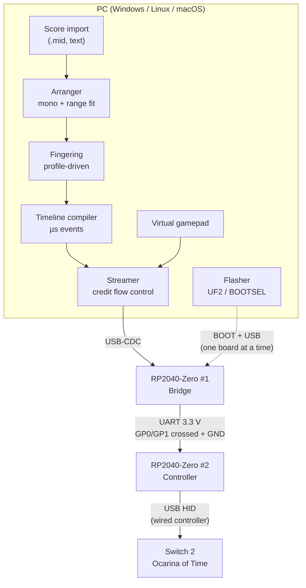
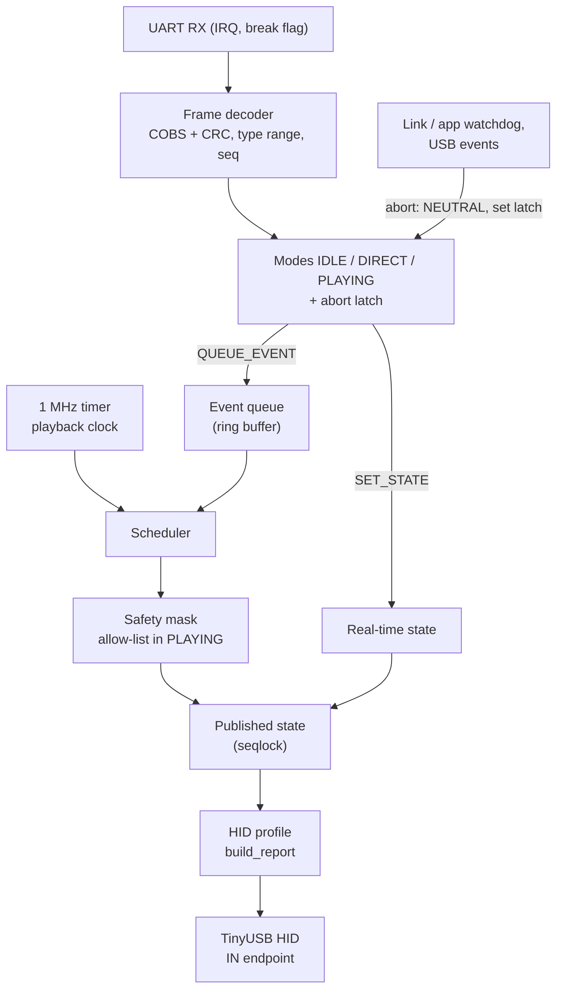
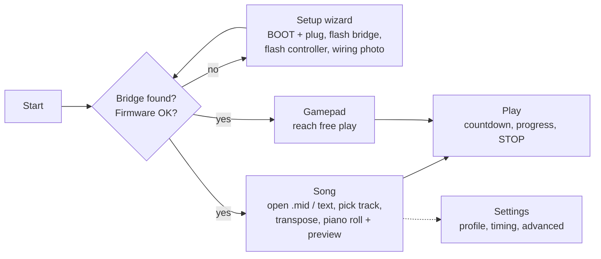

# Architecture diagrams

Mermaid sources from the notes. "Host" in labels = the app. Link sequence, USB enumeration and score pipeline diagrams live in `docs/link-protocol.md`, `docs/usb-controller-emulation.md`, `docs/score-format-and-mapping.md`.

## System

## Controller board internals

## GUI screens (first idea, Rust + egui per ADR-008)

