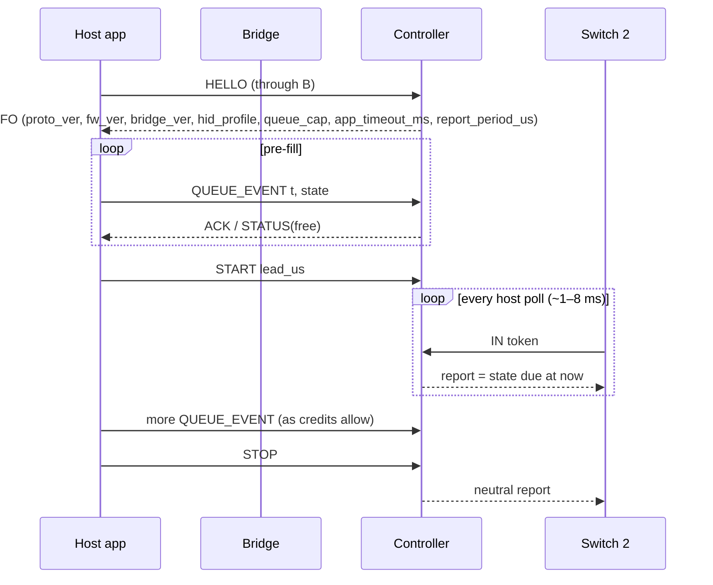

# Bonooru: Link protocol (PC, bridge, controller)

*Converted from the author's org-roam notes on 2026-11-19. This file is now the reference in the repo.*

> In this repo the host app lives in `app/`.

> **Precedence.** The ADs in the architecture spine (`_bmad-output/planning-artifacts/architecture/architecture-bonooru-2026-11-19/ARCHITECTURE-SPINE.md`, AD-3 to AD-8 and AD-19) and the conformance vectors in `firmware/common/proto/vectors/` take precedence over this doc. A wire change edits the vectors first (AD-14).

Topic: Bonooru (author's notes)

## Layers

| Hop                 | Transport                              | Who parses it                        |
|---------------------|----------------------------------------|--------------------------------------|
| PC → bridge         | USB-CDC (virtual COM port)             | nobody: the bridge is a frame-aware pipe; it finds `0x00` delimiters but never decodes, and injects its own `HEARTBEAT` frames (see Watchdog) |
| bridge → controller | UART 8N1, 460800 baud, no flow control | controller board                     |
| controller → PC     | same path, reverse                     | host app                             |

So **one** protocol, end to end, between host app and controller board (plus the link-local `HEARTBEAT`, bridge → controller only). The bridge only (AD-4):
- PC → UART, **store-and-forward per COBS frame**: scans for `0x00` delimiters but never decodes; writes whole frames to the UART, at most one app frame in flight plus one queued; a due heartbeat goes out at the next frame boundary, ahead of queued app frames; the rest of the buffering stays in CDC, so USB backpressure is the flow control
- drops (and counts) a run longer than `OCB_MAX_ENCODED_FRAME` bytes without a delimiter; discards a partial frame when DTR falls or CDC unmounts
- UART → PC, **best effort**: copies bytes as they come, drops (and counts) them when the CDC IN FIFO is full
- never blocks on any code path
- ignores the baud rate the PC sets, **except** 1200 baud = reboot into BOOTSEL (convention used by pico-sdk/Arduino)
- exposes a unique USB product string (`Bonooru Bridge`) + serial number, so the host finds it without asking

### Why 460800 baud **[HYPOTHESIS — unverified]**

- Proven by 2wiCC on the same wiring; bandwidth is ~46 kB/s → ~2800 events/s, music needs < 100/s
- Could go to 921600 if needed; keep it a build constant

## Framing

- COBS-encoded frames, delimiter `0x00` → resync after any garbage byte
- Frame payload: `type:u8 | seq:u8 | len:u8 | body[len] | crc16:u16le` (CRC-16/CCITT-FALSE)
- Little-endian everywhere
- Sizes: `len` is a u8, so `OCB_MAX_BODY = 255`; a raw frame is 3 + body + 2 bytes, from `OCB_MIN_RAW_FRAME = 5` to `OCB_MAX_RAW_FRAME = 260`. COBS adds at most `ceil(n / 254)` bytes, so the largest frame is `OCB_MAX_ENCODED_FRAME = 262` non-delimiter bytes (`OCB_MAX_WIRE_FRAME = 263` with its `0x00`). This value is derived, not chosen: a run of more than 262 bytes without a delimiter can never be a legal frame, which is the AD-4 drop rule. At 460800 baud a 263-byte frame takes 5.7 ms, so a heartbeat due behind it still meets the 27 ms gap (20 + 6 ≤ 27, checked at compile time).
- **Empty frame** = a zero-length run between two delimiters (`00 00`, or a leading `00`). It is counted and dropped, never an error: the `0x00` that opens a session (AD-7) and idle `0x00` bytes are empty frames. An encoded `01` (decodes to zero bytes) is not empty: it is a too-short frame, a CRC error.
- Trade-off vs an ASCII line protocol (2wiCC style): ASCII is easier to type in a terminal; binary is smaller and has a CRC. Plan: binary on the wire + a hidden "advanced" panel in the GUI that shows and sends frames for debugging.

## Controller state (8 bytes, mirrors the HID report)

| Field   | Type | Notes                        |
|---------|------|------------------------------|
| buttons | u16  | canonical P1 bit order, for every profile (AD-10): bit 0 Y, 1 B, 2 A, 3 X, 4 L, 5 R, 6 ZL, 7 ZR, 8 −, 9 +, 10 L3, 11 R3, 12 Home, 13 Capture |
| hat     | u8   | 0–7 directions clockwise (0 up, 1 up-right, 2 right, 3 down-right, 4 down, 5 down-left, 6 left, 7 up-left), 8 = neutral |
| lx, ly  | u8   | left stick, 0x80 = centre    |
| rx, ry  | u8   | right stick                  |
| flags   | u8   | bit 0 = END (only on the last `QUEUE_EVENT`, state = `NEUTRAL`); bits 1–7 reserved, must be 0 (AD-8) |

The controller board translates this to the active USB profile (HID or Pro Controller), see [USB controller emulation](usb-controller-emulation.md).

## Messages

### Type ranges (AD-3)

| Range       | Direction         | Rules |
|-------------|-------------------|-------|
| `0x01–0x3F` | app → controller  |       |
| `0x40–0x7F` | bridge → controller | link-local: never forwarded to the app, never ACKed, outside the app `seq` space |
| `0x80–0xFF` | controller → app  |       |

A receiver counts and drops empty frames and types outside its range. Receive-check order: COBS decode → length/`len` consistency (a failure counts as a CRC error) → CRC → type range → seq → semantics.

| Type | Name        | Dir | Body                                      | Purpose                                     |
|------|-------------|-----|-------------------------------------------|---------------------------------------------|
| 0x01 | HELLO       | H→C | proto_ver:u8                              | start session                               |
| 0x81 | INFO        | C→H | proto_ver:u8, fw_ver[3], bridge_ver[3], hid_profile:u8, queue_cap:u16, app_timeout_ms:u16, report_period_us:u16 | answer to HELLO; byte 0 (`proto_ver`) frozen forever (AD-7) |
| 0x02 | SET_STATE   | H→C | state[8]                                  | real-time input (virtual gamepad)           |
| 0x03 | QUEUE_EVENT | H→C | t_us:u32, state[8]                        | "at t_us after START, report becomes state" |
| 0x04 | START       | H→C | lead_us:u32                               | playback clock starts at now + lead         |
| 0x05 | STOP        | H→C | –                                         | clear queue, go neutral, → IDLE, clear abort latch |
| 0x06 | PING        | H→C | –                                         | app keep-alive, DIRECT mode only            |
| 0x40 | HEARTBEAT   | B→C | bridge_fw_ver[3], flags (bit 0 = DTR)     | link heartbeat, own rolling seq; body prefix frozen (AD-4) |
| 0x83 | STATUS      | C→H | free:u16, now_us:u32, last_seq, mode, abort_count, last_event, flags:u8 (bit0 link_ok, bit1 console_ready) (+ debug counters) | see "Controller → app reporting" |
| 0x84 | ACK         | C→H | seq                                       | cumulative: all frames up to `seq` accepted |
| 0x85 | NAK         | C→H | reason, expected, got                     | see "Reliability"                           |
| 0x86 | EVENT       | C→H | code                                      | `PLAYBACK_DONE`, `LINK_LOST`, `LATE`, `UNDERRUN`, `USB_SUSPENDED`, … |

Numeric values: `firmware/common/proto/include/ocb_proto/consts.h`, mirrored in `vectors/constants.txt`; those two win on a disagreement. Unknown EVENT codes and NAK reasons are logged, never fatal (AD-19). `0x82` is unassigned (reserved).

**Body sizes and length rules.** All fields little-endian. A body shorter than its v1 size, or of the wrong length for a fixed-size message, is a semantic error (`BODY_LEN` in the codec; the consumer chooses the reply), not a frame error.

| Message     | Body (v1)                                                                 | Bytes    | Length rule |
|-------------|---------------------------------------------------------------------------|----------|-------------|
| HELLO       | `proto_ver u8`                                                            | 1        | `≥ 1`, trailing bytes ignored |
| INFO        | `proto_ver u8, fw_ver[3], bridge_ver[3], hid_profile u8, queue_cap u16, app_timeout_ms u16, report_period_us u16` | 14 | `≥ 14`, trailing bytes ignored |
| SET_STATE   | `state[8]`                                                                | 8        | exact |
| QUEUE_EVENT | `t_us u32, state[8]`                                                      | 12       | exact |
| START       | `lead_us u32`                                                             | 4        | exact |
| STOP, PING  | none                                                                      | 0        | exact |
| HEARTBEAT   | `bridge_fw_ver[3], flags u8`                                              | 4        | `≥ 4`, trailing bytes ignored |
| STATUS      | `free u16, now_us u32, last_seq u8, mode u8, abort_count u8, last_event u8, flags u8` (+ debug counters) | 11 (+ n) | `≥ 11`, trailing bytes are debug counters |
| ACK         | `seq u8`                                                                  | 1        | exact |
| NAK         | `reason u8, expected u8, got u8`                                          | 3        | exact |
| EVENT       | `code u8`                                                                 | 1        | exact |

`abort_count` is a u8 that wraps.

NAK reasons (AD-6): transport reasons are `0x01–0x0F`, semantic reasons `0x10–0x7F`.

| Reason         | Value  | Class     |
|----------------|--------|-----------|
| `CRC`          | `0x01` | transport |
| `SEQ`          | `0x02` | transport |
| `FULL`         | `0x03` | transport |
| `VERSION`      | `0x10` | semantic  |
| `BUSY`         | `0x11` | semantic  |
| `ORDER`        | `0x12` | semantic  |
| `BAD_STATE`    | `0x13` | semantic  |
| `UNKNOWN_TYPE` | `0x14` | semantic  |
| `NO_LINK`      | `0x15` | semantic  |
| `NOT_READY`    | `0x16` | semantic  |
| `ABORTED`      | `0x17` | semantic  |

EVENT codes (AD-5, AD-8); the same values are used in `STATUS.last_event`:

| Code            | Value  |
|-----------------|--------|
| `NONE`          | `0x00` (only in `STATUS.last_event`: no event yet) |
| `PLAYBACK_DONE` | `0x01` |
| `LINK_LOST`     | `0x02` |
| `LATE`          | `0x03` |
| `UNDERRUN`      | `0x04` |
| `USB_SUSPENDED` | `0x05` |

`STATUS.mode`: `IDLE 0x00`, `DIRECT 0x01`, `PLAYING 0x02`. `INFO.hid_profile`: `UNKNOWN 0x00`, `P1 0x01`, `P2 0x02`, `P3 0x03` (see [USB controller emulation](usb-controller-emulation.md)). `PROTO_VERSION` is `1`.

## Flow control and timing

- Credit based: `credit = STATUS.free − (QUEUE_EVENTs sent after STATUS.last_seq)`; queue size is `INFO.queue_cap` (default 512 events), never hard-coded in the app (AD-6, AD-7)
- Host prefills the queue, sends START, then sends greedily whenever there is credit; the streamer never edits, drops or reorders events (AD-15)
- Events carry **absolute** time from START → no accumulated drift; device clock is the only clock
- Underrun (queue empty before the piece ends, judged when an event is applied) → go neutral and send `EVENT UNDERRUN` (a stuck note is worse than a gap); see "Controller modes"
- `PING`: DIRECT mode only, whenever the app has been idle for `app_timeout_ms/4` (AD-7)
- Watchdog: two levels, see below

### Timing constants

Named in `consts.h` (units in the name) and mirrored in `vectors/constants.txt`.

| Constant                     | Value     | Source |
|------------------------------|-----------|--------|
| `OCB_LINK_BAUD`              | 460800    | AD-4 (a build constant) |
| `OCB_HEARTBEAT_PERIOD_MS`    | 20        | AD-4 |
| `OCB_HEARTBEAT_MAX_GAP_MS`   | 27        | AD-4, F.7 |
| `OCB_LINK_TIMEOUT_MS`        | 80        | AD-5 default |
| `OCB_LINK_TIMEOUT_MAX_MS`    | 100       | AD-5, NFR-05 |
| `OCB_ACK_TIMEOUT_MS`         | 50        | AD-6 |
| `OCB_ACK_WINDOW`             | 64        | AD-6 (max unACKed frames, stale window) |
| `OCB_HELLO_RESEND_MS`        | 100       | AD-7 |
| `OCB_APP_TIMEOUT_MS_DEFAULT` | 1000      | AD-5, until W.1 |
| `OCB_APP_PING_DIVISOR`       | 4         | AD-7 (`PING` after `app_timeout_ms / 4` idle) |
| `OCB_STATUS_PERIOD_MS`       | 50        | AD-19 |
| `OCB_STATUS_MIN_GAP_MS`      | 10        | AD-19 |
| `OCB_CONSOLE_POLL_STALL_MS`  | 100       | AD-19 |
| `OCB_QUEUE_CAP_DEFAULT`      | 512       | AD-6, AD-7 |
| `OCB_T_US_LIMIT`             | 2^31      | AD-8 |
| `OCB_STOP_NEUTRAL_MS`        | 100       | NFR-05 |

## Watchdog (decided 2026-11-19)

Protects against an input staying pressed on the console. Three failure cases, handled separately:

| Case                                                   | Detection                         | Timeout   |
|--------------------------------------------------------|-----------------------------------|-----------|
| A. Bridge unplugged / unpowered, or UART wire pulled   | link level (bridge heartbeat)     | ≤ 100 ms (NFR-05, A.3) |
| B. App crashed or frozen, bridge still powered         | app level (app `PING`)            | `app_timeout_ms` (INFO; default 1000 ms until W.1), DIRECT mode only |
| C. Host OS hiccup (scheduling, USB, sleep)             | must **not** trip anything during playback | – |

- **Link level:** the bridge firmware emits its own heartbeat on the UART, independent of the app and of the USB state. The bridge is deterministic, so this cannot false-trip on host jitter. Heartbeats are injected only at frame boundaries. Encoding (AD-4): `HEARTBEAT`, type `0x40`, bridge → controller, a normal COBS+CRC frame with its own rolling seq and body `bridge_fw_ver[3], flags` (bit 0 = CDC DTR asserted). A hardware alarm drives it every 20 ms; wire spacing ≤ 27 ms. Controller (AD-5): no valid heartbeat within `OCB_LINK_TIMEOUT_MS` (≤ 100 ms, default 80) or a UART break (bridge unpowered → RX line low) → abort to IDLE (neutral) + `EVENT LINK_LOST`. While the link is down, `START` and `SET_STATE` get `NAK NO_LINK`.
- **App level:** only in DIRECT mode (`SET_STATE`, virtual gamepad). The app sends `PING` when idle for `app_timeout_ms/4`; no app frame for `app_timeout_ms` → abort to IDLE (neutral). A DTR falling edge seen in `HEARTBEAT.flags` counts as an app timeout in DIRECT mode. Exact value set from the soak test (test plan, W.1).
- **During playback:** no app-level timeout. If the app dies the queue plays out and the underrun rule sends the controller neutral.
- After a `STOP`: neutral within 100 ms.

## Reliability (AD-6)

- **Go-back-N.** `seq` is a u8 that wraps. The controller accepts only `seq == expected`. Window: at most 64 unACKed frames; the app sends at most `min(credit, 64 − unacked)` frames.
- **Stale frames.** A seq in `[expected−64, expected−1]` gets a cumulative `ACK(expected−1)` and has no effect; a duplicate of `expected−1` gets the cached response it got the first time.
- **Cumulative ACK.** The app resends from its oldest unACKed frame after `OCB_ACK_TIMEOUT_MS` (50 ms).
- **Transport NAKs** (`CRC`, `SEQ`, `FULL`) never advance `expected`; at most one per value of `expected`. The app rewinds only on a NAK whose `expected` is ahead of its last rewind point.
- **Semantic NAKs** (`VERSION`, `BUSY`, `ORDER`, `BAD_STATE`, `UNKNOWN_TYPE`, `NO_LINK`, `NOT_READY`, `ABORTED`) advance `expected`; the frame has no effect. After a semantic NAK on `QUEUE_EVENT` or `START`, the app abandons the piece and sends `STOP`.
- **Sync points.** `HELLO` and `STOP` are accepted with any seq, in any state, and set `expected = seq+1`.
- **Credits.** `credit = STATUS.free − (QUEUE_EVENTs sent after STATUS.last_seq)`.

## Session start and versioning (AD-7)

- On open the app asserts DTR and writes one `0x00`, then sends `HELLO` and nothing else until `INFO` arrives, resending every 100 ms.
- `HELLO` has STOP semantics and is always answered with `INFO`. Until a matching HELLO arrives, every other app frame except STOP gets `NAK VERSION`. Only an exact `PROTO_VERSION` match is accepted.
- `NAK VERSION` mid-session = the controller rebooted: the app sends HELLO again.
- `INFO.bridge_ver` comes from the last HEARTBEAT (zeros if none); `report_period_us` is the measured median IN interval (0 if unknown).
- Frozen forever: frame layout, COBS and CRC rules, type codes `0x01` / `0x81`, the HELLO body, byte 0 of INFO, the HEARTBEAT body prefix.

## Controller modes (AD-8)

Core 1 owns the modes IDLE, DIRECT and PLAYING.

| Frame             | IDLE                       | DIRECT                                 | PLAYING      |
|-------------------|----------------------------|----------------------------------------|--------------|
| `SET_STATE`       | → DIRECT                   | apply                                  | NAK `BUSY`   |
| `QUEUE_EVENT`     | enqueue (prefill)          | enqueue (prefill)                      | enqueue      |
| `START lead_us`   | → PLAYING, t0 = now + lead | real-time state → NEUTRAL, → PLAYING   | NAK `BUSY`   |
| `STOP` / `HELLO`  | NEUTRAL, clear queue, clear `aborted` | same, → IDLE                | same, → IDLE |

- **Entering IDLE** always publishes `NEUTRAL`, clears the queue and resets the ordering baseline.
- **Abort latch.** Any transition to IDLE the app did not request sets `aborted`: END applied, underrun, `LATE`, link loss, app timeout, USB suspend/unmount/bus reset in any mode, core stall. While set, `QUEUE_EVENT`, `START` and `SET_STATE` get `NAK ABORTED`. Only `STOP` or `HELLO` clears it.
- **Ordering.** `t_us` must be strictly increasing (else `NAK ORDER`) and < 2^31.
- **End of piece.** The last event is `END = NEUTRAL|END` (state `NEUTRAL`, `flags` bit 0 set); any other state with END gets `NAK BAD_STATE`. Applying it sends `EVENT PLAYBACK_DONE`.
- **Underrun** is judged at apply time: if a non-END event is applied and the queue is then empty, the controller publishes NEUTRAL in the same loop pass and sends `EVENT UNDERRUN`.
- **LATE.** If the head event is overdue by more than one report period, the controller aborts with `EVENT LATE` and never fires a backlog.
- **Not ready.** `START` and `SET_STATE` get `NAK NOT_READY` while the HID profile's `ready()` is false (console handshake not complete). The same predicate drives `STATUS.flags.console_ready`.
- **Safety mask (AD-9).** In PLAYING every applied state is masked by a compile-time allow-list: L, R, A, X, Y, hat, left stick. Other buttons are cleared, the right stick is centred. DIRECT mode is not masked.

### Rules the controller core applies (Story 2.4)

The firmware's `controller/core` (`ocb_core`) implements the table above. The rules below are not visible in the conformance vectors; the app's link layer (Story 3.3) follows this text. No wire value is added.

- **NAK precedence** for `SET_STATE`, `QUEUE_EVENT` and `START`, first match wins: `ABORTED` → `NO_LINK` (`SET_STATE` / `START` only, while the bridge link is down; Story 2.7) → `BUSY` (`SET_STATE` / `START` in PLAYING) → `NOT_READY` (`SET_STATE` / `START` only; `QUEUE_EVENT` is accepted while not ready) → `BAD_STATE` → `ORDER` (`QUEUE_EVENT` only) → `FULL` (`QUEUE_EVENT` only). Content errors come before `FULL`, so a malformed frame never turns into a retry loop. Only `FULL` is a transport NAK (does not advance `expected`); every other reason is semantic.
- **Validation (`NAK BAD_STATE`):**
  - a body of the wrong length for its type (`SET_STATE` 8, `QUEUE_EVENT` 12, `START` 4, `PING` 0 bytes);
  - `SET_STATE` and `QUEUE_EVENT`: `hat` above 8, or a reserved `flags` bit (1–7) set; button bits 14 and 15 are not refused (masked in PLAYING, ignored by the profile in DIRECT);
  - `SET_STATE` with any flag set (END is a queue concept);
  - `QUEUE_EVENT` with END on a state that is not the neutral pose;
  - `QUEUE_EVENT` while an END is already queued (nothing may follow END; reset on entering IDLE);
  - `START` with an empty queue (nothing would ever end PLAYING; prefill first).

  The last two (`QUEUE_EVENT` after a queued END → `NAK BAD_STATE`, `START` on an empty queue → `NAK BAD_STATE`) are refusals AD-8 does not list; the app's link layer (Story 3.3) must mirror them.
- **Never refused:** `STOP` and `HELLO` act whatever their body length. `PING` is ACKed in every mode, also while `aborted`, and changes nothing. An unassigned app type (`0x07`–`0x3F`) gets `NAK UNKNOWN_TYPE`.
- **HELLO version check comes first.** The core never reads `proto_ver`: every HELLO it is given is a sync point (enter IDLE, clear the latch, `expected = seq+1`). The controller's link layer (Story 2.6) must therefore check `proto_ver` (AD-7) **before** passing a HELLO to the core, and answer a mismatch itself; whether a mismatched HELLO should still force NEUTRAL (fail safe) is decided there.
- **Abort causes**, every one in any mode; each enters IDLE (NEUTRAL, queue cleared, ordering reset) and sets `aborted`:

  | Cause | EVENT |
  |---|---|
  | END applied | `PLAYBACK_DONE` |
  | underrun | `UNDERRUN` |
  | head overdue (LATE) | `LATE` |
  | link loss | `LINK_LOST` |
  | USB suspend, unmount, bus reset | `USB_SUSPENDED` |
  | app timeout, core stall | none (the app learns it from STATUS `mode` / `abort_count`) |

  `abort_count` (u8, wraps, never reset) increments when the latch goes from clear to set, so a normal piece end counts too: `PLAYBACK_DONE` / `last_event` tell a normal end from a failure. A cause arriving while `aborted` is already set changes nothing and sends no EVENT. `last_event` is the last EVENT sent; STOP and HELLO do not clear it.
- **Scheduler:** nothing runs before `t0 = now + lead_us`. The head event is due at `t0 + t_us`; at most one event is applied per scheduler pass, so the published states follow the queue order. Before applying, if the head is overdue by **more than** one report period (`INFO.report_period_us`; 8000 µs while unknown), the controller aborts with `LATE` and fires nothing (exactly one period late is still applied). After applying: an END aborts with `PLAYBACK_DONE`; otherwise, if the queue is now empty, NEUTRAL is published in the same pass and `UNDERRUN` sent, so the last non-END note before an underrun lasts zero time.

### Rules the controller link applies (Story 2.6)

The firmware's `controller/link` (`ocb_link`) sits between the UART and the core. The rules below make the AD text concrete where it is silent; the app's link layer (Story 3.3) follows them. **No wire value changed**: no new message, NAK reason, EVENT code, constant or `PROTO_VERSION` bump, and the conformance vectors are unchanged. Controller-only tuning values live in `firmware/controller/link/include/ocb_link/config.h`, not in `consts.h`.

- **Admission order.** For every frame that passed COBS, length, CRC and type range, first match wins:

  | Step | Frame | Result |
  |---|---|---|
  | 1 | any app frame (`0x01–0x3F`) | counted for the app-gap debug counter |
  | 2 | `HEARTBEAT` (`0x40`) | stored (bridge version, DTR flag, time), never ACKed or NAKed, never reaches the core; other bridge types are counted and ignored |
  | 3 | `STOP`, any seq | executed (neutral, queue cleared, IDLE, latch cleared, `expected = seq+1`), ACK |
  | 3 | `HELLO`, `proto_ver` = `PROTO_VERSION` | executed like STOP, session open, INFO |
  | 3 | `HELLO`, other `proto_ver` or empty body | INFO, session closed, the core forced neutral (below), no ACK |
  | 4 | session not open (any other app frame) | `NAK VERSION`, `expected = seq+1` |
  | 5 | `seq == expected` | the core decides (ACK, a semantic NAK, or `NAK FULL`) |
  | 5 | `d = (expected − seq) mod 256` = 1 | the cached response (below) |
  | 5 | `2 ≤ d ≤ 64` | `ACK(expected−1)`, no effect |
  | 5 | any other seq | `NAK SEQ` |

  The session gate comes **before** the seq check: a controller that rebooted (`expected = 0`) answers an app still sending seq 120 with `NAK VERSION`, not `NAK SEQ`, so the app's rule "`NAK VERSION` mid-session = reboot, send HELLO" can fire. Sync points (`HELLO`, `STOP`) are always executed, never treated as stale duplicates.
- **Cached response.** The controller remembers the reply it gave to the last frame the core handled (other than a sync point): an ACK or a semantic NAK. A duplicate of `expected−1` gets the same content again (a new controller tx seq, so the bytes may differ). After a sync point the cache is empty and a duplicate gets `ACK(expected−1)`.
- **NAK fields.** `NAK(reason, expected, got)`: `expected` is the controller's `expected` **after** handling the frame (`seq+1` for a semantic NAK, unchanged for a transport NAK); `got` is the offending frame's seq, `0` for `CRC` (the seq of a damaged frame is unknown).
- **One transport NAK per `expected`.** `CRC`, `SEQ` and `FULL` share one budget: at most one transport NAK per value of `expected`, re-armed when `expected` changes or at a sync point. After one damaged frame, the frames already in flight get no NAK each. A frame dropped for COBS, length, CRC or overlong requests `NAK CRC` through this budget; a type-range error or an empty frame gets no reply. A lost NAK is repaired by the app's 50 ms resend.
- **Mismatched HELLO** (`proto_ver` ≠ `PROTO_VERSION`, or an empty body): answered with INFO (byte 0 is the controller's own `proto_ver`, so the app sees the mismatch), the session is closed, and the core goes neutral as if it had received a `STOP` with the HELLO's seq (fail safe: an unknown peer never leaves an input held; `expected = seq+1`). The session is closed at boot and by a mismatched HELLO only; link loss, aborts and USB events set the abort latch instead (recovered with STOP or HELLO).
- **RX error bytes.** The UART delivers each character with its framing, parity, break and overrun bits. A character with any of them set is not data: it is discarded, counted, and it ends the frame in progress as a dropped frame (a `NAK CRC` request), so the next bytes start a fresh frame even without a leading `0x00`. The zero character a UART break loads is therefore never taken as a frame delimiter. Breaks are counted for the watchdog (Story 2.7). A receive buffer overflow is handled like one error byte at the place where bytes were lost.
- **`link_ok`** (STATUS flags bit 0) is set by every valid HEARTBEAT and cleared by a link loss (heartbeat timeout, or a break while the link is up); `NAK NO_LINK` and `EVENT LINK_LOST` follow from it. The rules are in "Rules the controller link applies (Story 2.7)" below.
- **`console_ready`** (STATUS flags bit 1, and the `NAK NOT_READY` gate, the same predicate): 1 after the console handshake; 0 after a USB suspend, unmount or bus reset until a new handshake; 0 while no IN report has been taken for more than 100 ms (exactly 100 ms is still ready). Suspend, unmount and bus reset also abort to IDLE with `EVENT USB_SUSPENDED` in any mode; the IN-poll stall does not abort.
- **TX priority and overflow.** Replies and reports go out as whole frames, one at a time, by priority **EVENT > NAK > INFO > ACK > STATUS** (INFO, the answer to HELLO, ranks with the replies). EVENT and NAK wait in small queues (8 and 4); when one is full the **new** entry is dropped and counted. ACK is cumulative and STATUS is a snapshot, so a newer one replaces the older one; INFO is replaced by a newer INFO. TX never blocks and never splits a frame.
- **Controller tx seq.** Controller → app frames carry a rolling u8 seq, one counter for all of them. It is diagnostic only; the app ignores it.
- **STATUS cadence.** The first STATUS goes out as soon as TX is allowed; then every 50 ms, plus one after an ACK is sent, never closer than 10 ms to the previous STATUS.
- **STATUS debug counters** (debug builds only, after the 11 base bytes, little-endian, every u16 saturating at 65535; every decoder ignores them, so a STATUS reader that knows only v1 reads the first 7 bytes and skips the rest):
  - v1, bytes 0–6: `max_app_gap_ms u16` (largest gap between two consecutive valid app frames since the last session open or close), `watchdog_trips u8` (watchdog rule firings, wraps; Story 2.7), `dropped_bytes u16` (= the sum of the next three), `tx_dropped u16` (EVENT and NAK entries dropped on overflow plus pending output discarded while TX is not allowed).
  - v2, bytes 7–20 (Story 2.6 D35): `rx_err_bytes u16` (characters received with a framing, parity, break or overrun bit, discarded), `rx_overflow_bytes u16` (characters lost because the controller's receive buffer was full), `overlong_bytes u16` (bytes of runs longer than 262 bytes without a delimiter), then the error bits seen: `rx_fe u16`, `rx_pe u16`, `rx_be u16`, `rx_oe u16` (framing, parity, break, overrun; one character may set several, so their sum can exceed `rx_err_bytes`). 21 bytes in all.
  - v3, bytes 21 and on (Story 2.3 D14): the P2 debug log window. `p2_log_total u16` (records ever logged, wraps at 65536, not saturated: a jump larger than `p2_log_n` between two STATUS frames means records were missed), `p2_log_n u8` (0 to 16), then `p2_log_n` records of 2 bytes, `kind u8, id u8`, oldest first: the newest 16 records. Kinds: `0x01` USB `0x80` command (id = the command), `0x02` subcommand (id), `0x03` another output report or a feature report (id = report id), `0x04` refusal (id = the refused command, subcommand or report), `0x05` the log ring overflowed (id = records lost, saturated at 255), `0x06` handshake complete (id 0), `0x07` profile restart (id = cause: `01` mount, `02` unmount, `03` suspend, `04` bus reset), `0x08` the first argument of the subcommand logged just before it (for `01`, `03`, `21`, `22`), `0x09` repeat (id = records not shown, saturated at 255). Repeats: a record equal to the two before it, or continuing a two-record cycle (A B A B) from the second B, is not stored; one repeat record after the last stored record counts them and is updated in place (`p2_log_total` counts it once), so a console that loops cannot fill the window. 24 bytes in all with an empty window, at most 56; a debug STATUS body is at most 67 bytes without the v4 block below. The window is filled only in debug builds (release builds have no debug log at all, AC5a).
  - v4, at offset `24 + 2 × p2_log_n` of the tail (Story 2.5 D13, D31): one fixed block of 41 bytes, the controller's self-timing (lateness from the core, core 0's numbers from the USB mailbox, the core 1 loop and stack from the link runner, the boot cause from the link configuration). Every u16 saturates at 65535.

    | Offset | Field | Meaning |
    |---|---|---|
    | 0 | `late_n u16` | events applied in PLAYING this run (reset at every accepted `START`, kept after the piece ends) |
    | 2 | `late_max_us u16` | the largest lateness at apply, `now − (t0 + t_us)` when `ocb_core_tick` applied the event |
    | 4 | `late_sum_us u32` | the sum of the lateness (saturating; the reader divides by `late_n`) |
    | 8 | `late_hist u16 × 6` | applied events per lateness bucket: `[0,50)`, `[50,100)`, `[100,250)`, `[250,1000)`, `[1000,4000)`, `[4000,∞)` µs; an event later than the LATE threshold is never applied, so never counted |
    | 20 | `loop_max_us u16` | the longest core 1 super-loop pass since `START` |
    | 22 | `core0_pass_max_us u16` | the longest core 0 pass (`usb_p2_task`) since the last profile restart; it bounds the stamp latency of the IN intervals |
    | 24 | `in_min_us u16`, `in_p95_us u16`, `in_max_us u16` | the IN interval spread: `in_p95_us` over the window of the median (the last 256 intervals up to 20 ms, 50 µs bins, 0 until 64 are in); `in_min_us` and `in_max_us` over every interval since the last restart (raw µs, stalls above 20 ms included; Story 2.5 D35), so a slow interval always lies within them |
    | 30 | `in_slow u16` | intervals longer than 1.5 × the median since the last restart (a missed poll), stalls above 20 ms included, counted once a median is published |
    | 32 | `seq_retries u16` | published-state reads that needed more than one try |
    | 34 | `seq_fallbacks u8` | published-state reads that returned NEUTRAL after 3 tries (saturates at 255) |
    | 35 | `stack_used_max u16` | the core 1 stack high-water mark, bytes (painted stack, scanned 8 words per pass) |
    | 37 | `boot_cause u8` | why the board last rebooted: `0` none (power-on), `1` core 0 stalled, `2` core 1 stalled, `3` core 1 never came alive |
    | 38 | `reboot_count u8` | liveness reboots since power-on |
    | 39 | `stall_reset_10us u16` | the last liveness reboot's interval from the stalled core's last loop pass to the reset, measured by the board itself (10 µs units; 0 after a power-on): core 0 stalled, the time until core 1 reboots; core 1 stalled, the time until the hardware watchdog fires, i.e. core 0's last feed plus the 60 ms timeout (Story 2.5 D34; the watchdog's own count register does not hold the remaining time on the RP2040) |

    With v4 the debug tail is 65 bytes with an empty window, at most 97; the largest debug STATUS body is 108 bytes (115 bytes on the wire), which fits the controller's 128-byte UART TX ring in one frame.
  - These are debug aids, not wire values: no `PROTO_VERSION` change, and a later debug layout may append more.
- **TX gate (AD-20).** At power-up the controller's RX has an internal pull-down and its TX pad stays high-Z. TX is driven only after RX has been high (idle) continuously for 1 ms (a value to confirm at the bench, test plan H.7); while TX is not allowed, pending replies are discarded, so no stale burst leaves when it opens. The link watchdog releases TX again on a break or link loss, after the `EVENT LINK_LOST` has left (Story 2.7, below).
- **Who drives first (both boards powered).** AD-20 as amended (2026-11-22, Story 2.6 D25, applied by Story 2.7) states this rule. Applied to both boards, "TX high-Z until RX sees idle-high" deadlocks: each RX is held low by its own pull-down and neither side ever drives. The rule is therefore asymmetric: the **bridge leads**, the controller follows. The controller keeps the gate above. The bridge (powered by the PC, Story 3.1), while its own RX does not show a live controller, probes: it drives TX idle-high for about 5 ms every 500 ms (≤ 1 % duty) and returns to high-Z in between; once its RX shows the controller (idle-high, or a valid frame), it keeps TX enabled, and it goes back to probing after a break or link loss. So the controller never drives a bridge that has not shown idle-high (the C5 case of an unplugged bridge fed by a Switch-powered controller), and the bridge drives an unpowered controller only in short probe pulses. The probe values are Story 3.1's to set and H.1 measures the result; if the unpowered side's 3V3 rail still rises, 1 kΩ series resistors in both data lines are the fallback (a wiring change, the owner's decision).
- **What the app must do** because of these rules: resend `HELLO` every 100 ms until `INFO` arrives (a HELLO is answered even if the session is already open); after a `NAK VERSION` mid-session, send `HELLO` again before anything else; and send nothing after a `STOP` until its ACK arrives, because a late duplicate `STOP` is executed again (harmless: it goes neutral) and would clear frames sent after it.

### Rules the controller link applies (Story 2.7)

The link watchdog of AD-5 lives in `controller/link` (`ocb_link/watchdog.h`, pure C). The rules below are what the controller does; the app's link layer (Story 3.3) and the bridge (Story 3.1) follow them. **No wire value changed**: `NO_LINK` (`0x15`), `LINK_LOST` (`0x02`), `HEARTBEAT` (`0x40`) and the `watchdog_trips` debug byte already existed; no message, NAK reason, EVENT code, constant or `PROTO_VERSION` changed, and the conformance vectors are unchanged. One controller-only value is added: `OCB_LINK_RELEASE_WAIT_US` (5000 µs, in `ocb_link/config.h`).

- **Arming.** The watchdog is armed by the first valid HEARTBEAT (a body of at least 4 bytes). Before it the link is down: STATUS `link_ok` is 0, `START` and `SET_STATE` get `NAK NO_LINK`, and nothing times out, so a controller powered without a bridge never latches and the break the UART sees at power-up does not abort anything.
- **Two limits, strictly greater.** Heartbeat timeout: armed and more than `OCB_LINK_TIMEOUT_MS` (80 ms) since the last valid HEARTBEAT was received. A build value above `OCB_LINK_TIMEOUT_MAX_MS` (100 ms) is clamped to it; exactly 80 ms is still alive, 80 ms + 1 µs trips. The 80 ms assume a heartbeat every `OCB_HEARTBEAT_PERIOD_MS` (20 ms) with a wire spacing of at most `OCB_HEARTBEAT_MAX_GAP_MS` (27 ms), so two lost heartbeats never trip. App timeout: more than `app_timeout_ms` (INFO; default `OCB_APP_TIMEOUT_MS_DEFAULT` (1000 ms)) since the last valid app frame; exactly 1000 ms is still alive. All times are the controller's 64-bit microsecond clock (the RP2040 timer: monotonic, no wrap in practice); a time earlier than a stored stamp counts as no time elapsed, so no timeout fires until the clock has passed that stamp again (suppressed, never early).
- **Break.** A break is a received character with the break bit (BE). Framing, parity or overrun errors alone are line noise, not breaks. The watchdog compares the break counter at every loop pass, before the scheduler, so a break acts at the next pass.
- **Link loss** (heartbeat timeout, or a break while armed), in this order: the core aborts to IDLE (NEUTRAL, queue cleared, latch set, `abort_count` + 1); `EVENT LINK_LOST` is queued, unless the latch was already set (then no second EVENT); `link_ok` goes to 0 and the watchdog disarms (one loss per arming); until the TX release completes only EVENTs are sent (pending ACK, NAK, INFO and STATUS are discarded and counted in `tx_dropped`); TX is released (pad high-Z) once the EVENT has been handed out and the UART is idle, or at the latest `OCB_LINK_RELEASE_WAIT_US` (5000 µs) after the loss; it is driven again only after RX has been idle-high for 1 ms (the TX gate above), and STATUS then resumes with `link_ok` 0. The loss is checked before the scheduler, so an event due in the same pass is never applied.
- **Break while the link is down** (never armed, or already lost): TX is released (the same sequence, with no EVENT pending), and nothing else happens: no abort, no EVENT, no trip.
- **Recovery.** The next valid HEARTBEAT sets `link_ok` to 1 and re-arms the watchdog. The latch stays until `STOP` or `HELLO`, and the session stays open (no `NAK VERSION`). A break and a HEARTBEAT received in the same pass while the link is up: the loss stands at that pass, and the following HEARTBEAT recovers. While the link is down (never armed, or already lost), a break followed by the arming HEARTBEAT in the same pass is not a loss: the HEARTBEAT takes the break counter as its baseline, the link comes up, and TX is still released once (the break rule below).
- **App timeout** (AD-5 case B): in DIRECT only. Any valid app frame (`0x01`–`0x3F`) counts, whatever its seq, session state or outcome (a stale duplicate or a frame that gets a NAK counts; a frame with a bad CRC does not; a HEARTBEAT is not an app frame). Entering DIRECT starts the clock (the entering `SET_STATE` is an app frame). It aborts with cause `APP_TIMEOUT`: latch set, NEUTRAL, IDLE, **no EVENT**, `link_ok` unchanged. In IDLE nothing is pressed; in PLAYING a dead app's queue plays out and the underrun rule ends the piece.
- **DTR edge.** `HEARTBEAT.flags` bit 0 is the bridge's CDC DTR; bits 1–7 are ignored. A HEARTBEAT with DTR 0 right after one with DTR 1, received while in DIRECT, aborts like an app timeout (no EVENT). The first HEARTBEAT ever, or the first after a link loss, is never an edge; the edge is not remembered for a later DIRECT (the app timeout covers that case).
- **`NAK NO_LINK`** is semantic (`expected = seq + 1`, fields `expected` after and `got = seq`, the cached response on a duplicate, no effect) and only for `SET_STATE` and `START`, between `ABORTED` and `BUSY` in the precedence. In practice a controller that loses the link while PLAYING or DIRECT has latched, so the app first sees `NAK ABORTED`.
- **`watchdog_trips`** (STATUS debug byte 2, u8, wraps): +1 each time a rule fires (heartbeat timeout, break while armed, app timeout, DTR edge), also when the latch was already set. A break while the link is down is not a trip.
- **NFR-05 budget.** A loss by silence is decided 80 ms after the last heartbeat, plus one loop pass, plus one HID report period for the console to read NEUTRAL (8 ms, measured on the Switch 2 in Story 2.3): about 89 ms, inside the 100 ms of NFR-05.
- **What the app must do** (Story 3.3): after `EVENT LINK_LOST`, or STATUS `link_ok` 0 with `abort_count` + 1, abandon the piece and send `STOP` (or `HELLO`) before anything else; after `abort_count` rises with no EVENT (app timeout, DTR edge) the same recovery; never send `START` or `SET_STATE` while `link_ok` is 0 (they get `NAK NO_LINK`, which advances `expected`); in DIRECT, send `PING` whenever no app frame was sent for `app_timeout_ms / OCB_APP_PING_DIVISOR` (`OCB_APP_PING_DIVISOR` (4)), and keep DTR asserted while the port is open. After a link loss or a wire fault, write one `0x00` before the next frame (it ends any partial run the controller's receiver may hold) and resend every unacknowledged frame after `OCB_ACK_TIMEOUT_MS`: a damaged frame gets at most one `NAK CRC` (`got` 0) and the frames sent after it get no reply at all (one transport NAK per `expected`), so only the resend recovers.
- **Bench emulation.** Until the bridge firmware exists (Story 3.1), `firmware/tools/link_probe.py` sends the HEARTBEAT itself through the transparent bench peer (`bridge_fw_ver` 0.0.1, DTR under the probe's control). A host stall longer than 60 ms between two heartbeat writes trips the controller correctly; the probe prints its own send gaps so such a trip can be told apart from a firmware fault.

### Rules the controller link applies (Story 2.3)

The USB profile (P2, `controller/profile_p2`) runs on core 0 and reaches the link only through the USB mailbox and, in debug builds, the debug log ring. **No wire value changed**: no message, NAK reason, EVENT code or constant, `PROTO_VERSION` stays 1, the conformance vectors are unchanged; only the debug STATUS tail grew (v3 above), which every decoder already skips.

- **`console_ready`** is now fed by the real profile: the mailbox gets a handshake when the console first asks for the input stream after a restart (USB command `80 04` or subcommand `03 30`), and an IN report each time the console takes one. The 100 ms stall rule is unchanged.
- **USB-down events.** Suspend, unmount and bus reset each restart the profile and post their mailbox counter, once per down episode: a bus reset before the device was configured (enumeration) posts nothing, so it is no abort.
- **`report_period_us`.** Core 0 measures the median interval between completions of `0x30` input reports (handshake replies are not counted; the last 256, published from 64 on, intervals above 20 ms ignored) and puts it in the mailbox; `ocb_link_poll` applies each new value to `INFO.report_period_us` and to the core's LATE threshold together (saturated at 65535). It is 0 (unknown, LATE falls back to `OCB_CORE_LATE_FALLBACK_US`, 8000 µs) until 64 intervals are in and again after any USB-down event. Story 2.5 (D14) keeps the fallback at 8000 µs, the measured median of the Switch 2, so a `START` right after a handshake gets the same LATE threshold as one later; the measured jitter of the IN intervals is recorded in docs/test-plan.md (H.18).

### Rules the controller applies (Story 2.5)

The firmware now has the shape of AD-11; the rules below are what the controller does. **No wire value changed**: no message, NAK reason, EVENT code or constant, `PROTO_VERSION` stays 1, the conformance vectors are unchanged; only the debug STATUS tail grew (v4 above), which every decoder skips. The new numbers are controller-only (`ocb_core/live.h`).

- **Published state.** Core 1 is the only writer of the state the USB report carries; core 0 reads it through a sequence-locked double buffer (two slots and a generation counter that counts half publishes), in every build, release included. A read is retried at most 3 times and then reports NEUTRAL; with two slots a read is disturbed only when the state is published twice during the copy, which does not happen in practice (the debug counters `seq_retries` and `seq_fallbacks` show it). A release controller therefore reports the real state from now on.
- **Liveness.** Each core counts its loop passes; the other core watches the count with its own clock. A count unchanged for more than `OCB_LIVE_STALE_US` (20 ms; exactly 20 ms is still alive) is a stalled core. Core 0 counts one pass per USB task pass, not per IN report: a console that stops polling is not a stalled core.
- **Core 1 stalled.** Core 0 reports NEUTRAL at the next IN poll and stops feeding the hardware watchdog (`OCB_WDT_TIMEOUT_MS`, 60 ms), which resets the board. **Core 0 stalled.** Core 1 aborts the core with the existing cause `CORE_STALL` (NEUTRAL, latch set, no EVENT) and reboots the board at once. Worst case from a stall to the reset: 20 ms + 60 ms + one loop pass (bound 5 ms) = 85 ms, inside the 100 ms of NFR-05. The watchdog is armed before core 1 starts, so a core 1 that never comes up is caught too.
- **The reset** restarts the whole chip but the oscillators, the USB controller included: the controller disappears from the USB bus and enumerates again, nothing pressed. The link starts again with the session closed (`NAK VERSION` mid-session = reboot, send `HELLO`, as before). The debug STATUS v4 reports `boot_cause`, `reboot_count` and the board's own stall-to-reset interval after it (kept in a third watchdog scratch register across the reset). A host sees the device disappear only after its own USB removal latency (about 110 ms inferred from the first Story 2.5 H.2a runs, calibrated by `p2_probe.py stall --runs N`), so the AC number is the board's.
- **What the app must do:** nothing new. A controller that rebooted is seen as before (no STATUS for a moment, then `NAK VERSION`, then a fresh session with `abort_count` 0).

## Controller → app reporting (AD-19)

- **STATUS body:** `free u16, now_us u32` (µs since t0; 0 when IDLE or during the lead), `last_seq` (= `expected−1`), `mode`, `abort_count`, `last_event`, `flags u8`. Debug builds add counters: max gap between app frames (W.1), watchdog trips, dropped bytes.
- **STATUS flags.** bit0 `link_ok` (bridge↔controller link up), bit1 `console_ready`; bits 2–7 reserved: the controller writes 0, the app ignores them. A new status bit takes a reserved bit without a `PROTO_VERSION` bump.
- **`console_ready`** is the profile's `ready()` when the STATUS is built ([usb-controller-emulation.md](usb-controller-emulation.md#profile-interface-ad-12)). `NAK NOT_READY` on `START` / `SET_STATE` is still sent; the flag lets the app show the console state without probing.
  - 1 once the console handshake completes (P2: the `0x80` handshake; P1: `SET_CONFIGURATION` and the first IN poll).
  - 0 on USB suspend (console asleep), unmount, bus reset, and when no IN report has been taken for > 100 ms (e.g. "Pro Controller Wired Communication" switched off without a bus event). The polling stall clears the flag only; it does not abort playback.
  - Controller unplugged or unpowered (bridge alone): no STATUS arrives at all, so the app shows both bridge↔controller and controller↔Switch as down.
- **Cadence.** STATUS every 50 ms, plus after ACKs, coalesced to at most one per 10 ms.
- **Mode in the app** is derived from STATUS; EVENT is only a fast path.
- **TX priority:** EVENT > NAK > INFO > ACK > STATUS (INFO, the answer to HELLO, ranks with the replies; overflow details in "Rules the controller link applies (Story 2.6)"). On overflow the lowest priority is dropped; TX never blocks.

## Risks

### USB-CDC on Windows buffers small writes **[RISK]**

Only affects throughput, not timing (events are timestamped). Batch frames per write.

### UART noise on loose jumper wires **[RISK]**

Handled by CRC + NAK/resend; keep wires short, shared GND mandatory.

## Related

- Bonooru: Architecture (author's notes)
- Bonooru ADR-003: Timing scheduled on the controller board (author's notes)
- [2wiCC protocol](https://github.com/knflrpn/2wiCC) (ASCII, frame-based queue, 460800 8N1): reference only
