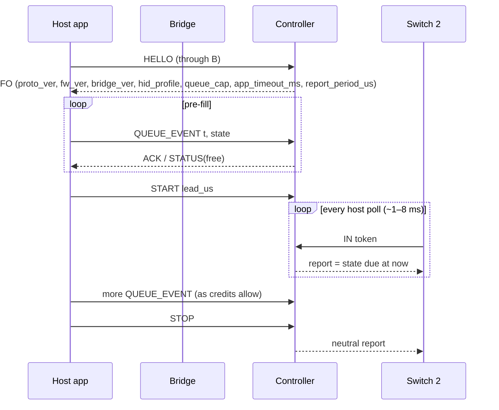

# Ocarina Bot: Link protocol (PC, bridge, controller)

*Converted from the author's org-roam notes on 2026-11-19. This file is now the reference in the repo.*

> In this repo the host app lives in `app/`.

> **Precedence.** The ADs in the architecture spine (`_bmad-output/planning-artifacts/architecture/architecture-ocarina-bot-2026-11-19/ARCHITECTURE-SPINE.md`, AD-3 to AD-8 and AD-19) and the conformance vectors in `firmware/common/proto/vectors/` take precedence over this doc. A wire change edits the vectors first (AD-14).

Topic: Ocarina Bot (author's notes)

## Layers

| Hop                 | Transport                              | Who parses it                        |
|---------------------|----------------------------------------|--------------------------------------|
| PC → bridge         | USB-CDC (virtual COM port)             | nobody: the bridge is a frame-aware pipe; it finds `0x00` delimiters but never decodes, and injects its own `HEARTBEAT` frames (see Watchdog) |
| bridge → controller | UART 8N1, 460800 baud, no flow control | controller board                     |
| controller → PC     | same path, reverse                     | host app                             |

So **one** protocol, end to end, between host app and controller board (plus the link-local `HEARTBEAT`, bridge → controller only). The bridge only (AD-4):
- PC → UART, **store-and-forward per COBS frame**: scans for `0x00` delimiters but never decodes; writes whole frames to the UART, at most one app frame in flight plus one queued; a due heartbeat goes out at the next frame boundary, ahead of queued app frames; the rest of the buffering stays in CDC, so USB backpressure is the flow control
- drops (and counts) a run longer than `OCB_MAX_ENCODED_FRAME` bytes without a delimiter; discards a partial frame when DTR falls or CDC unmounts
- UART → PC, **best effort**: copies bytes as they come, drops (and counts) them when the CDC IN FIFO is full
- never blocks on any code path
- ignores the baud rate the PC sets, **except** 1200 baud = reboot into BOOTSEL (convention used by pico-sdk/Arduino)
- exposes a unique USB product string (`Ocarina Bot Bridge`) + serial number, so the host finds it without asking

### Why 460800 baud **[HYPOTHESIS — unverified]**

- Proven by 2wiCC on the same wiring; bandwidth is ~46 kB/s → ~2800 events/s, music needs < 100/s
- Could go to 921600 if needed; keep it a build constant

## Framing

- COBS-encoded frames, delimiter `0x00` → resync after any garbage byte
- Frame payload: `type:u8 | seq:u8 | len:u8 | body[len] | crc16:u16le` (CRC-16/CCITT-FALSE)
- Little-endian everywhere
- Trade-off vs an ASCII line protocol (2wiCC style): ASCII is easier to type in a terminal; binary is smaller and has a CRC. Plan: binary on the wire + a hidden "advanced" panel in the GUI that shows and sends frames for debugging.

## Controller state (8 bytes, mirrors the HID report)

| Field   | Type | Notes                        |
|---------|------|------------------------------|
| buttons | u16  | canonical P1 bit order, for every profile (AD-10): bit 0 Y, 1 B, 2 A, 3 X, 4 L, 5 R, 6 ZL, 7 ZR, 8 −, 9 +, 10 L3, 11 R3, 12 Home, 13 Capture |
| hat     | u8   | 0–7 directions, 8 = neutral  |
| lx, ly  | u8   | left stick, 0x80 = centre    |
| rx, ry  | u8   | right stick                  |
| flags   | u8   | bit 0 = END (only on the last `QUEUE_EVENT`, state = `NEUTRAL`); bits 1–7 reserved, must be 0 (AD-8) |

The controller board translates this to the active USB profile (HID or Pro Controller), see [USB controller emulation](usb-controller-emulation.md).

## Messages

### Type ranges (AD-3)

| Range       | Direction         | Rules |
|-------------|-------------------|-------|
| `0x01–0x3F` | app → controller  |       |
| `0x40–0x7F` | bridge → controller | link-local: never forwarded to the app, never ACKed, outside the app `seq` space |
| `0x80–0xFF` | controller → app  |       |

A receiver counts and drops empty frames and types outside its range. Receive-check order: COBS decode → length/`len` consistency (a failure counts as a CRC error) → CRC → type range → seq → semantics.

| Type | Name        | Dir | Body                                      | Purpose                                     |
|------|-------------|-----|-------------------------------------------|---------------------------------------------|
| 0x01 | HELLO       | H→C | proto_ver:u8                              | start session                               |
| 0x81 | INFO        | C→H | proto_ver:u8, fw_ver[3], bridge_ver[3], hid_profile:u8, queue_cap:u16, app_timeout_ms:u16, report_period_us:u16 | answer to HELLO; byte 0 (`proto_ver`) frozen forever (AD-7) |
| 0x02 | SET_STATE   | H→C | state[8]                                  | real-time input (virtual gamepad)           |
| 0x03 | QUEUE_EVENT | H→C | t_us:u32, state[8]                        | "at t_us after START, report becomes state" |
| 0x04 | START       | H→C | lead_us:u32                               | playback clock starts at now + lead         |
| 0x05 | STOP        | H→C | –                                         | clear queue, go neutral, → IDLE, clear abort latch |
| 0x06 | PING        | H→C | –                                         | app keep-alive, DIRECT mode only            |
| 0x40 | HEARTBEAT   | B→C | bridge_fw_ver[3], flags (bit 0 = DTR)     | link heartbeat, own rolling seq; body prefix frozen (AD-4) |
| 0x83 | STATUS      | C→H | free:u16, now_us:u32, last_seq, mode, abort_count, last_event, flags:u8 (bit0 link_ok, bit1 console_ready) (+ debug counters) | see "Controller → app reporting" |
| 0x84 | ACK         | C→H | seq                                       | cumulative: all frames up to `seq` accepted |
| 0x85 | NAK         | C→H | reason, expected, got                     | see "Reliability"                           |
| 0x86 | EVENT       | C→H | code                                      | `PLAYBACK_DONE`, `LINK_LOST`, `LATE`, `UNDERRUN`, `USB_SUSPENDED`, … |

NAK reasons (AD-6): transport `CRC`, `SEQ`, `FULL`; semantic `VERSION`, `BUSY`, `ORDER`, `BAD_STATE`, `UNKNOWN_TYPE`, `NO_LINK`, `NOT_READY`, `ABORTED`. EVENT codes (AD-5, AD-8): `PLAYBACK_DONE`, `LINK_LOST`, `LATE`, `UNDERRUN`, `USB_SUSPENDED`. Numeric values are set in `ocb_proto` and the vectors. Unknown EVENT codes and NAK reasons are logged, never fatal (AD-19).

## Flow control and timing

- Credit based: `credit = STATUS.free − (QUEUE_EVENTs sent after STATUS.last_seq)`; queue size is `INFO.queue_cap` (default 512 events), never hard-coded in the app (AD-6, AD-7)
- Host prefills the queue, sends START, then sends greedily whenever there is credit; the streamer never edits, drops or reorders events (AD-15)
- Events carry **absolute** time from START → no accumulated drift; device clock is the only clock
- Underrun (queue empty before the piece ends, judged when an event is applied) → go neutral and send `EVENT UNDERRUN` (a stuck note is worse than a gap); see "Controller modes"
- `PING`: DIRECT mode only, whenever the app has been idle for `app_timeout_ms/4` (AD-7)
- Watchdog: two levels, see below

## Watchdog (decided 2026-11-19)

Protects against an input staying pressed on the console. Three failure cases, handled separately:

| Case                                                   | Detection                         | Timeout   |
|--------------------------------------------------------|-----------------------------------|-----------|
| A. Bridge unplugged / unpowered, or UART wire pulled   | link level (bridge heartbeat)     | ≤ 100 ms (NFR-05, A.3) |
| B. App crashed or frozen, bridge still powered         | app level (app `PING`)            | `app_timeout_ms` (INFO; default 1000 ms until W.1), DIRECT mode only |
| C. Host OS hiccup (scheduling, USB, sleep)             | must **not** trip anything during playback | – |

- **Link level:** the bridge firmware emits its own heartbeat on the UART, independent of the app and of the USB state. The bridge is deterministic, so this cannot false-trip on host jitter. Heartbeats are injected only at frame boundaries. Encoding (AD-4): `HEARTBEAT`, type `0x40`, bridge → controller, a normal COBS+CRC frame with its own rolling seq and body `bridge_fw_ver[3], flags` (bit 0 = CDC DTR asserted). A hardware alarm drives it every 20 ms; wire spacing ≤ 27 ms. Controller (AD-5): no valid heartbeat within `OCB_LINK_TIMEOUT_MS` (≤ 100 ms, default 80) or a UART break (bridge unpowered → RX line low) → abort to IDLE (neutral) + `EVENT LINK_LOST`. While the link is down, `START` and `SET_STATE` get `NAK NO_LINK`.
- **App level:** only in DIRECT mode (`SET_STATE`, virtual gamepad). The app sends `PING` when idle for `app_timeout_ms/4`; no app frame for `app_timeout_ms` → abort to IDLE (neutral). A DTR falling edge seen in `HEARTBEAT.flags` counts as an app timeout in DIRECT mode. Exact value set from the soak test (test plan, W.1).
- **During playback:** no app-level timeout. If the app dies the queue plays out and the underrun rule sends the controller neutral.
- After a `STOP`: neutral within 100 ms.

## Reliability (AD-6)

- **Go-back-N.** `seq` is a u8 that wraps. The controller accepts only `seq == expected`. Window: at most 64 unACKed frames; the app sends at most `min(credit, 64 − unacked)` frames.
- **Stale frames.** A seq in `[expected−64, expected−1]` gets a cumulative `ACK(expected−1)` and has no effect; a duplicate of `expected−1` gets the cached response it got the first time.
- **Cumulative ACK.** The app resends from its oldest unACKed frame after `OCB_ACK_TIMEOUT_MS` (50 ms).
- **Transport NAKs** (`CRC`, `SEQ`, `FULL`) never advance `expected`; at most one per value of `expected`. The app rewinds only on a NAK whose `expected` is ahead of its last rewind point.
- **Semantic NAKs** (`VERSION`, `BUSY`, `ORDER`, `BAD_STATE`, `UNKNOWN_TYPE`, `NO_LINK`, `NOT_READY`, `ABORTED`) advance `expected`; the frame has no effect. After a semantic NAK on `QUEUE_EVENT` or `START`, the app abandons the piece and sends `STOP`.
- **Sync points.** `HELLO` and `STOP` are accepted with any seq, in any state, and set `expected = seq+1`.
- **Credits.** `credit = STATUS.free − (QUEUE_EVENTs sent after STATUS.last_seq)`.

## Session start and versioning (AD-7)

- On open the app asserts DTR and writes one `0x00`, then sends `HELLO` and nothing else until `INFO` arrives, resending every 100 ms.
- `HELLO` has STOP semantics and is always answered with `INFO`. Until a matching HELLO arrives, every other app frame except STOP gets `NAK VERSION`. Only an exact `PROTO_VERSION` match is accepted.
- `NAK VERSION` mid-session = the controller rebooted: the app sends HELLO again.
- `INFO.bridge_ver` comes from the last HEARTBEAT (zeros if none); `report_period_us` is the measured median IN interval (0 if unknown).
- Frozen forever: frame layout, COBS and CRC rules, type codes `0x01` / `0x81`, the HELLO body, byte 0 of INFO, the HEARTBEAT body prefix.

## Controller modes (AD-8)

Core 1 owns the modes IDLE, DIRECT and PLAYING.

| Frame             | IDLE                       | DIRECT                                 | PLAYING      |
|-------------------|----------------------------|----------------------------------------|--------------|
| `SET_STATE`       | → DIRECT                   | apply                                  | NAK `BUSY`   |
| `QUEUE_EVENT`     | enqueue (prefill)          | enqueue (prefill)                      | enqueue      |
| `START lead_us`   | → PLAYING, t0 = now + lead | real-time state → NEUTRAL, → PLAYING   | NAK `BUSY`   |
| `STOP` / `HELLO`  | NEUTRAL, clear queue, clear `aborted` | same, → IDLE                | same, → IDLE |

- **Entering IDLE** always publishes `NEUTRAL`, clears the queue and resets the ordering baseline.
- **Abort latch.** Any transition to IDLE the app did not request sets `aborted`: END applied, underrun, `LATE`, link loss, app timeout, USB suspend/unmount/bus reset in any mode, core stall. While set, `QUEUE_EVENT`, `START` and `SET_STATE` get `NAK ABORTED`. Only `STOP` or `HELLO` clears it.
- **Ordering.** `t_us` must be strictly increasing (else `NAK ORDER`) and < 2^31.
- **End of piece.** The last event is `END = NEUTRAL|END` (state `NEUTRAL`, `flags` bit 0 set); any other state with END gets `NAK BAD_STATE`. Applying it sends `EVENT PLAYBACK_DONE`.
- **Underrun** is judged at apply time: if a non-END event is applied and the queue is then empty, the controller publishes NEUTRAL in the same loop pass and sends `EVENT UNDERRUN`.
- **LATE.** If the head event is overdue by more than one report period, the controller aborts with `EVENT LATE` and never fires a backlog.
- **Not ready.** `START` and `SET_STATE` get `NAK NOT_READY` while the HID profile's `ready()` is false (console handshake not complete). The same predicate drives `STATUS.flags.console_ready`.
- **Safety mask (AD-9).** In PLAYING every applied state is masked by a compile-time allow-list: L, R, A, X, Y, hat, left stick. Other buttons are cleared, the right stick is centred. DIRECT mode is not masked.

## Controller → app reporting (AD-19)

- **STATUS body:** `free u16, now_us u32` (µs since t0; 0 when IDLE or during the lead), `last_seq` (= `expected−1`), `mode`, `abort_count`, `last_event`, `flags u8`. Debug builds add counters: max gap between app frames (W.1), watchdog trips, dropped bytes.
- **STATUS flags.** bit0 `link_ok` (bridge↔controller link up), bit1 `console_ready`; bits 2–7 reserved: the controller writes 0, the app ignores them. A new status bit takes a reserved bit without a `PROTO_VERSION` bump.
- **`console_ready`** is the profile's `ready()` when the STATUS is built ([usb-controller-emulation.md](usb-controller-emulation.md#profile-interface-ad-12)). `NAK NOT_READY` on `START` / `SET_STATE` is still sent; the flag lets the app show the console state without probing.
  - 1 once the console handshake completes (P2: the `0x80` handshake; P1: `SET_CONFIGURATION` and the first IN poll).
  - 0 on USB suspend (console asleep), unmount, bus reset, and when no IN report has been taken for > 100 ms (e.g. "Pro Controller Wired Communication" switched off without a bus event). The polling stall clears the flag only; it does not abort playback.
  - Controller unplugged or unpowered (bridge alone): no STATUS arrives at all, so the app shows both bridge↔controller and controller↔Switch as down.
- **Cadence.** STATUS every 50 ms, plus after ACKs, coalesced to at most one per 10 ms.
- **Mode in the app** is derived from STATUS; EVENT is only a fast path.
- **TX priority:** EVENT > NAK > ACK > STATUS. On overflow the lowest priority is dropped; TX never blocks.

## Risks

### USB-CDC on Windows buffers small writes **[RISK]**

Only affects throughput, not timing (events are timestamped). Batch frames per write.

### UART noise on loose jumper wires **[RISK]**

Handled by CRC + NAK/resend; keep wires short, shared GND mandatory.

## Related

- Ocarina Bot: Architecture (author's notes)
- Ocarina Bot ADR-003: Timing scheduled on the controller board (author's notes)
- [2wiCC protocol](https://github.com/knflrpn/2wiCC) (ASCII, frame-based queue, 460800 8N1): reference only
