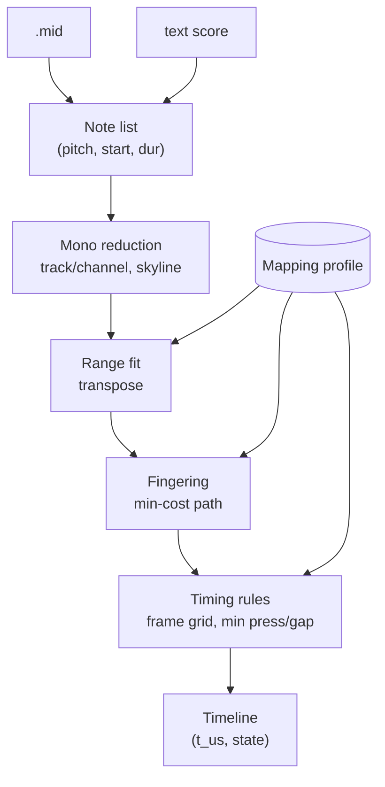

# Bonooru: Score format and note mapping

*Converted from the author's org-roam notes on 2026-11-19. This file is now the reference in the repo.*

Topic: Bonooru (author's notes)

## Pipeline



Common internal model: a list of `(midi_pitch, start_s, duration_s)`. Both input formats produce it.

## Steps

| Step           | Rule                                                                                                                                                                                     |
|----------------|------------------------------------------------------------------------------------------------------------------------------------------------------------------------------------------|
| Mono reduction | user picks track/channel; chords → highest note ("skyline"); overlaps → cut the earlier note                                                                                             |
| Range fit      | try every shift in −24…+24 semitones, keep the one with fewest out-of-range notes (tie: smallest shift, then most natural notes); left-over notes → octave-fold or drop, always reported |
| Fingering      | each pitch has 1+ input combos; choose the sequence with lowest total cost (Viterbi / DP)                                                                                                |
| Timing rules   | snap to the frame grid; enforce min press, min gap on same button, modifier lead; steal time from the previous note, never shift onsets; at most one note button held (U3); notes longer than `max_sustain_ms` are re-pressed (U1) and counted |
| Timeline       | absolute µs events of full controller states (see [Link protocol](link-protocol.md))                                                                                                     |

### Fingering cost (first idea)

| Transition                        |                     Cost |
|-----------------------------------|-------------------------:|
| no modifier change                |                        0 |
| D-pad change                      |                        1 |
| stick change                      |                        2 |
| stick passes through centre (↑→↓) |                       +1 |
| same button retriggered           | +1 (needs a release gap) |
| non-natural fingering             |        0.1 (tie breaker) |

Weights live in the profile's `[cost]` table (keys `dpad_change`, `stick_change`, `stick_through_centre`, `same_button_retrigger`, `non_natural`; "no modifier change" is 0 and has no key). They are a **design default, not measured**: the data supports only the order no change < D-pad change < stick change (the D-pad steps at once, the stick glides: U4, test plan rows 1.5 and 2.3), not the numbers. Tuned after [tests](test-plan.md) (Story 1.6 listening, Story 5.5, Epic 7).

## Mapping profile (TOML, one per game version)

Source of truth: [`app/profiles/oot-switch2-1.1.1.toml`](../app/profiles/oot-switch2-1.1.1.toml) (bundled default for OoT 1.1.1, Story 1.5). Every value there has a comment with its test plan row and a tag (`MEASURED`, `MARGIN`, `OWNER CHOICE`, `ESTIMATE`, `DESIGN DEFAULT`). Shape (abridged; Story 5.1 owns loading, validation and the schema):

```toml
schema = 1                 # integer (AD-17)

[profile]
name = "OoT Switch 2"      # (name, game_version) = what a user copy overrides (AD-17)
game_version = "1.1.1"
frame_rate = 60            # U10: frame period 16.67 ms when the picture changes (test plan 2.5)

[buttons]                  # natural pitches, sounding (MIDI numbers, test plan 1.1 / 1.9)
L = 74  # D5
R = 77  # F5
A = 81  # A5
Y = 83  # B5
X = 86  # D6

[modifiers]                # semitone offsets, then the stick as canonical state bytes (AD-10)
dpad_up = 1
dpad_down = -1
stick_up = 2               # only at full travel (U6)
stick_down = -2
stick_up_ly = 0x00         # wire Y 0xE00
stick_down_ly = 0xFF       # wire Y 0x20C
stick_lx = 0x80            # centred: any X component reduces the bend

[range]                    # sounding pitch: the game plays one octave above the community chart
low = 71    # B4
high = 89   # F6

[timing]                   # *_frames = integer frames on the frame grid (ms in the comments); *_ms = ms
min_press_frames = 3            # 50 ms: measured 2 frames (U7, test plan 2.1) + 1 frame margin
min_gap_same_button_frames = 5  # 83.3 ms: owner choice, not a measured limit (U2, test plan 2.2)
modifier_lead_frames = 1        # 16.7 ms: measured 0 frames (U5, test plan 2.3) + 1 frame margin
max_sustain_ms = 6000           # measured 6500 ms on A (U1, test plan 1.10) - 500 ms margin; L R Y X assumed equal
start_lead_ms = 500             # design default, not measured

[cost]                     # fingering cost weights, design default (not measured), see above
dpad_change = 1
stick_change = 2
stick_through_centre = 1
same_button_retrigger = 1
non_natural = 0.1

[[fingerings]]             # 45 rows: every button x D-pad x stick combination (test plan 1.9)
button = "L"
dpad = "down"              # none / up / down
stick = "down"             # none / up / down
pitch = 71                 # measured sounding pitch = button + D-pad offset + stick offset
chart = true               # true for the 19 chart fingerings
```

Why these units: the three grid values are integer frames because every measurement is in frames and the pipeline snaps to the frame grid (2 or 5 frames in ms are not integers, so ms would risk off-by-one rounding at the snap). `max_sustain_ms` and `start_lead_ms` are not on the frame grid.

## Text score format (draft)

```text
# title: Ode to Joy (excerpt)
tempo 120          # quarter notes per minute
transpose 0
E4/4 E4/4 F4/4 G4/4 | G4/4 F4/4 E4/4 D4/4
C4/4 C4/4 D4/4 E4/4 | E4/4. D4/8 D4/2
r/4                # rest
```

- Note: `<name><accidental?><octave>/<denominator>[.]`, `#` or `b` accidentals
- `|` bar lines are optional and only checked
- Tempo changes anywhere: `tempo 90`
- Also accepted: raw `ms` durations (`E4:250`) for non-metric tests

## Live MIDI keyboard (analysis)

| Aspect        | File playback              | Live keyboard                                                                 |
|---------------|----------------------------|-------------------------------------------------------------------------------|
| Fingering     | global optimum, look-ahead | greedy, no look-ahead                                                         |
| Modifier lead | scheduled before the onset | adds lead time to **every** bent note                                         |
| Latency       | irrelevant (pre-scheduled) | key → sound = host + USB + UART + poll + frame + audio ≈ 3–6 frames **[HYPOTHESIS — unverified]** |
| Feel          | exact                      | noticeably late for a player                                                  |

Conclusion: possible as a "fun mode" (real-time `SET_STATE`), after file playback works. Decision: ADR-007 (author's notes).

## Libraries (app)

The app is Rust + egui/eframe (ADR-008):

- `midly` (Unlicense) to read `.mid` files; `midir` (MIT) for live input
- plain Rust for the rest; MusicXML import is not planned (ADR-007)

## Related

- [Ocarina of Time (Switch 2): ocarina input mechanics](ocarina-input-mechanics.md)
- Bonooru: Requirements (author's notes)
