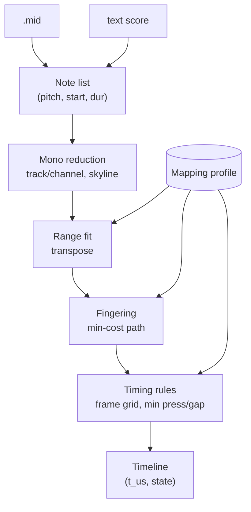

# Ocarina Bot: Score format and note mapping

*Converted from the author's org-roam notes on 2026-11-19. This file is now the reference in the repo.*

Topic: Ocarina Bot (author's notes)

## Pipeline



Common internal model: a list of `(midi_pitch, start_s, duration_s)`. Both input formats produce it.

## Steps

| Step           | Rule                                                                                                                                                                                     |
|----------------|------------------------------------------------------------------------------------------------------------------------------------------------------------------------------------------|
| Mono reduction | user picks track/channel; chords → highest note ("skyline"); overlaps → cut the earlier note                                                                                             |
| Range fit      | try every shift in −24…+24 semitones, keep the one with fewest out-of-range notes (tie: smallest shift, then most natural notes); left-over notes → octave-fold or drop, always reported |
| Fingering      | each pitch has 1+ input combos; choose the sequence with lowest total cost (Viterbi / DP)                                                                                                |
| Timing rules   | snap to the frame grid; enforce min press, min gap on same button, modifier lead; steal time from the previous note, never shift onsets                                                  |
| Timeline       | absolute µs events of full controller states (see [Link protocol](link-protocol.md))                                                                                                     |

### Fingering cost (first idea)

| Transition                        |                     Cost |
|-----------------------------------|-------------------------:|
| no modifier change                |                        0 |
| D-pad change                      |                        1 |
| stick change                      |                        2 |
| stick passes through centre (↑→↓) |                       +1 |
| same button retriggered           | +1 (needs a release gap) |
| non-natural fingering             |        0.1 (tie breaker) |

Weights live in the profile, tuned after [tests](test-plan.md).

## Mapping profile (TOML, one per game version)

```toml
[profile]
name = "OoT Switch 2 v1.0.0"
frame_rate = 60            # U10, to measure

[buttons]                  # natural pitches (MIDI numbers)
L = 62  # D4
R = 65  # F4
A = 69  # A4
Y = 71  # B4
X = 74  # D5

[modifiers]                # semitone offsets
dpad_up = 1
dpad_down = -1
stick_up = 2               # ly = 0x00
stick_down = -2            # ly = 0xFF
stick_value = 0x00         # deflection used, U6

[timing]                   # all in ms, to measure (U5, U7, U2)
min_press = 50
min_gap_same_button = 34
modifier_lead = 17
start_lead = 500

[range]
low = 59    # B3
high = 77   # F5
```

## Text score format (draft)

```text
# title: Ode to Joy (excerpt)
tempo 120          # quarter notes per minute
transpose 0
E4/4 E4/4 F4/4 G4/4 | G4/4 F4/4 E4/4 D4/4
C4/4 C4/4 D4/4 E4/4 | E4/4. D4/8 D4/2
r/4                # rest
```

- Note: `<name><accidental?><octave>/<denominator>[.]`, `#` or `b` accidentals
- `|` bar lines are optional and only checked
- Tempo changes anywhere: `tempo 90`
- Also accepted: raw `ms` durations (`E4:250`) for non-metric tests

## Live MIDI keyboard (analysis)

| Aspect        | File playback              | Live keyboard                                                                 |
|---------------|----------------------------|-------------------------------------------------------------------------------|
| Fingering     | global optimum, look-ahead | greedy, no look-ahead                                                         |
| Modifier lead | scheduled before the onset | adds lead time to **every** bent note                                         |
| Latency       | irrelevant (pre-scheduled) | key → sound = host + USB + UART + poll + frame + audio ≈ 3–6 frames **[HYPOTHESIS — unverified]** |
| Feel          | exact                      | noticeably late for a player                                                  |

Conclusion: possible as a "fun mode" (real-time `SET_STATE`), after file playback works. Decision: ADR-007 (author's notes).

## Libraries (app)

The app is Rust + egui/eframe (ADR-008):

- `midly` (Unlicense) to read `.mid` files; `midir` (MIT) for live input
- plain Rust for the rest; MusicXML import is not planned (ADR-007)

## Related

- [Ocarina of Time (Switch 2): ocarina input mechanics](ocarina-input-mechanics.md)
- Ocarina Bot: Requirements (author's notes)
