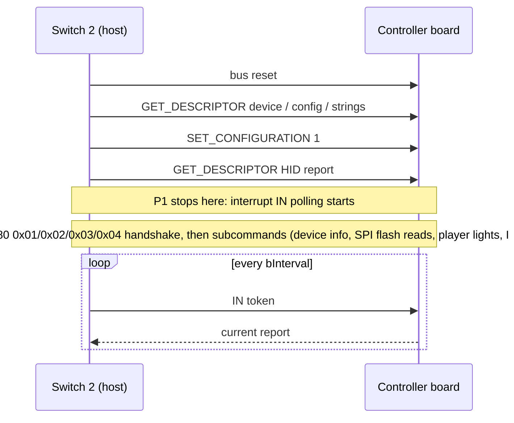

# Bonooru: USB controller emulation

*Converted from the author's org-roam notes on 2026-11-19. This file is now the reference in the repo.*

Topic: Bonooru (author's notes)

## Candidate profiles

| Profile                                    |   VID:PID | Handshake                                     | Switch setting needed                   | Evidence on Switch 2                                             | Open reference                |
|--------------------------------------------|----------:|-----------------------------------------------|-----------------------------------------|------------------------------------------------------------------|-------------------------------|
| P1. HORI "POKKEN CONTROLLER" (generic HID) | 0F0D:0092 | none: plain HID                               | none (to verify)                        | GP2040-CE Switch mode reported working (community post, 2025-06) | GP2040-CE (MIT)               |
| P2. Switch 1 Pro Controller, wired         | 057E:2009 | USB `0x80` commands + subcommands, 0x30 reports | "Pro Controller Wired Communication" ON | RiiDraw, 2wiCC run on Switch 2                                   | 2wiCC (no licence), docs only |
| P3. Switch 2 Pro Controller                | 057E:2069 | complex, incl. AES key exchange               | auto wired                              | ProBridge-S2 (RP2040-Zero, 1000 Hz)                              | ProBridge-S2 (MIT)            |

Choice: **P2** (ADR-002 (author's notes), accepted 2026-11-18). Every input the ocarina needs (L, R, A, Y, X, D-pad, left stick) plus menu navigation (B, +, ZL/ZR) exists in all three.

## P1: HID report (8 bytes IN)

| Byte | Field   | Values                                                                                    |
|------|---------|-------------------------------------------------------------------------------------------|
| 0–1  | buttons | bit 0 Y, 1 B, 2 A, 3 X, 4 L, 5 R, 6 ZL, 7 ZR, 8 −, 9 +, 10 L3, 11 R3, 12 Home, 13 Capture |
| 2    | hat     | 0 up, 1 up-right, 2 right … 7 up-left, 8 neutral                                          |
| 3–4  | lx, ly  | 0x00–0xFF, 0x80 centre (Y axis: 0x00 = up)                                                |
| 5–6  | rx, ry  | idem                                                                                      |
| 7    | vendor  | 0x00                                                                                      |

- Ocarina modifiers in this layout: D-pad ↑/↓ → `hat` 0 / 4; stick ↑/↓ → `ly` 0x00 / 0xFF
- **Canonical link state (AD-10).** This P1 button order, hat encoding and stick convention is the canonical 8-byte state on the link for **every** profile, including P2. Only the HID profile module turns it into a USB report.
- OUT report (8 bytes) exists in the descriptor; content ignored

## P1: descriptors (from GP2040-CE `SwitchDescriptors.h`)

| Item             | Value                                                 |
|------------------|-------------------------------------------------------|
| Strings          | "HORI CO.,LTD." / "POKKEN CONTROLLER"                 |
| bcdUSB           | 2.00, full speed, EP0 64 bytes                        |
| Interface        | 1× HID, no boot protocol                              |
| Endpoints        | IN 0x81, OUT 0x02, 64 bytes, bInterval 1              |
| HID report desc. | 86 bytes (copy from GP2040-CE, MIT, with attribution) |
| Power            | 500 mA declared (bus powered)                         |

## Profile interface (AD-12)

- Exactly one profile is linked per build (`OCB_PROFILE`, default `P2`); `INFO.hid_profile` carries its id (one id per profile: P1, P2, P3; numeric values set in `ocb_proto`).
- Interface: descriptors, a control/OUT-report handler (the handshake), `build_report(const ocb_state*)`, `tick()` and `ready()`.
- `ready()` is true once the console handshake is complete (P1: `SET_CONFIGURATION` and the first IN poll); until then `START` and `SET_STATE` get `NAK NOT_READY` (AD-8). It is also reported passively as `STATUS.flags.console_ready` (AD-19).
- `ready()` returns to false on USB suspend, unmount or bus reset, and when no IN report has been taken for more than 100 ms (covers "Wired Communication" switched off without a bus event; flag only, not an abort cause).
- A profile reads only the published state; it never reaches into the scheduler.
- P2 refuses firmware-update subcommands (C7) and restarts its handshake after a bus reset. Debug builds only: subcommands are logged through the SPSC ring.
- `INFO.report_period_us` is the median IN interval measured on the device (0 if unknown, AD-7). It answers the polling-rate hypothesis below without a sniffer.

## Enumeration

## Timing chain

| Stage                                   | Delay (estimate)   | Controlled by us |
|-----------------------------------------|--------------------|------------------|
| scheduler fires → report buffer updated | < 10 µs            | yes              |
| report waits for host poll              | 0 … polling period | no (measure)     |
| console → game input sampling           | 0 … 1 game frame   | no               |
| game → audio out                        | constant           | no               |

Constant parts don't matter (the whole piece shifts); variable parts set the jitter.

### Switch 2 polls a full-speed HID device every 1 ms **[HYPOTHESIS — unverified]**

bInterval 1 asks for 1 ms; the host may poll slower (8 ms is common on Switch 1 for the Pro Controller). Measured on the device: the controller reports the median IN interval as `INFO.report_period_us` (AD-7, AD-12); a USB sniffer or a debug-build GPIO toggle on every IN transfer is a cross-check.

### The game's frame period is 16.67 ms (60 Hz) while the ocarina plays **[VERIFIED 2026-11-21]**

Measured in free play (test plan row 2.5, U10): a 240 fps video of the screen shows the picture changing on a 16.67 ms grid. Evidence limits: only one scene type was tested (free play, handheld); the 240 fps capture resolves frame boundaries only to about ±4 ms (one capture frame, 4.17 ms); a sustained 60 distinct images every second is not shown (the scene did not move continuously). Defines the quantisation grid of the score compiler (profile `frame_rate = 60`).

### The game samples input once per frame **[HYPOTHESIS — unverified]**

Consistent with test plan row 2.4 (per-note latency in two clusters one frame apart while the sender's grid is not phase-locked to the game), but the input sampling rate itself is not directly measured. Could be 30 fps in some scenes (only one scene type tested).

## Risks

### Switch 2 rejects or ignores P1 in this game **[RISK]**

Generic HORI pads may be accepted by the system but mapped differently per game. No longer blocking: P2 is the chosen profile, P1 is an optional later simplification.

### P2 handshake details are reverse-engineered **[RISK]**

Without a licence on 2wiCC, implement from public reverse-engineering docs (e.g. dekuNukem's Nintendo_Switch_Reverse_Engineering) and test.

## Related

- [Bonooru: Link protocol (PC, bridge, controller)](link-protocol.md)
- [Ocarina of Time (Switch 2): ocarina input mechanics](ocarina-input-mechanics.md)
- [GP2040-CE](https://github.com/OpenStickCommunity/GP2040-CE), [ProBridge-S2](https://github.com/neur0ner25/ProBridge-S2), [2wiCC](https://github.com/knflrpn/2wiCC)
