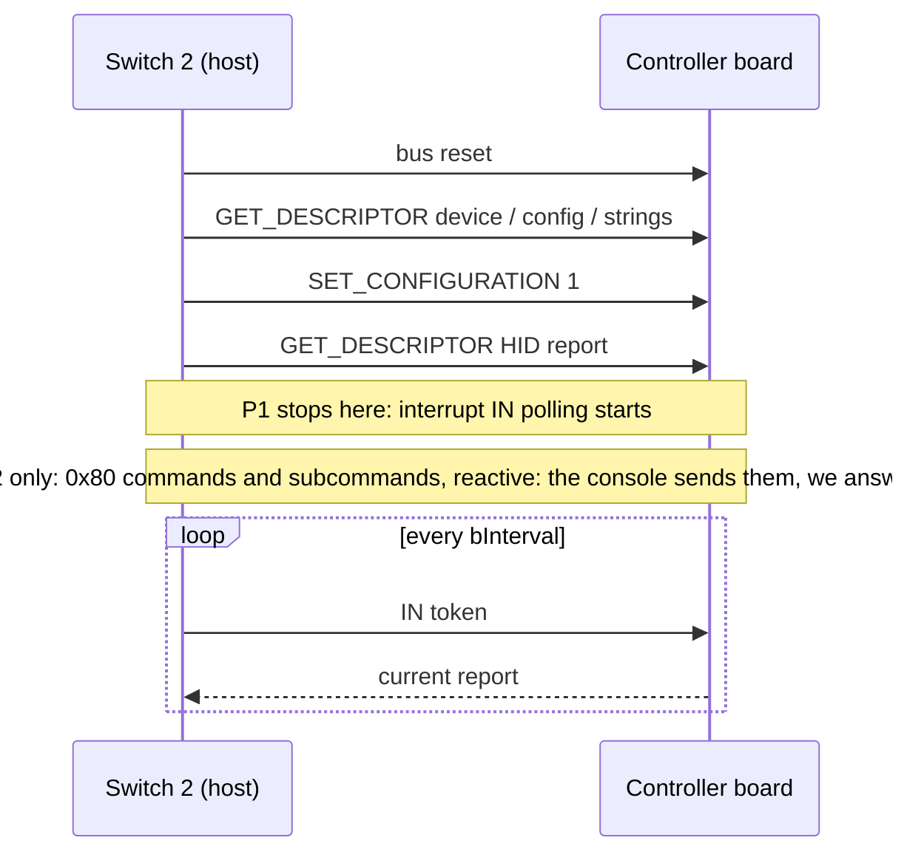

# Bonooru: USB controller emulation

*Converted from the author's org-roam notes on 2026-11-19. This file is now the reference in the repo.*

Topic: Bonooru (author's notes)

## Candidate profiles

| Profile                                    |   VID:PID | Handshake                                     | Switch setting needed                   | Evidence on Switch 2                                             | Open reference                |
|--------------------------------------------|----------:|-----------------------------------------------|-----------------------------------------|------------------------------------------------------------------|-------------------------------|
| P1. HORI "POKKEN CONTROLLER" (generic HID) | 0F0D:0092 | none: plain HID                               | none (to verify)                        | GP2040-CE Switch mode reported working (community post, 2025-06) | GP2040-CE (MIT)               |
| P2. Switch 1 Pro Controller, wired         | 057E:2009 | USB `0x80` commands + subcommands, 0x30 reports | "Pro Controller Wired Communication" ON | RiiDraw, 2wiCC run on Switch 2                                   | 2wiCC (no licence), docs only |
| P3. Switch 2 Pro Controller                | 057E:2069 | complex, incl. AES key exchange               | auto wired                              | ProBridge-S2 (RP2040-Zero, 1000 Hz)                              | ProBridge-S2 (MIT)            |

Choice: **P2** (ADR-002 (author's notes), accepted 2026-11-18). Every input the ocarina needs (L, R, A, Y, X, D-pad, left stick) plus menu navigation (B, +, ZL/ZR) exists in all three.

## P1: HID report (8 bytes IN)

| Byte | Field   | Values                                                                                    |
|------|---------|-------------------------------------------------------------------------------------------|
| 0–1  | buttons | bit 0 Y, 1 B, 2 A, 3 X, 4 L, 5 R, 6 ZL, 7 ZR, 8 −, 9 +, 10 L3, 11 R3, 12 Home, 13 Capture |
| 2    | hat     | 0 up, 1 up-right, 2 right … 7 up-left, 8 neutral                                          |
| 3–4  | lx, ly  | 0x00–0xFF, 0x80 centre (Y axis: 0x00 = up)                                                |
| 5–6  | rx, ry  | idem                                                                                      |
| 7    | vendor  | 0x00                                                                                      |

- Ocarina modifiers in this layout: D-pad ↑/↓ → `hat` 0 / 4; stick ↑/↓ → `ly` 0x00 / 0xFF
- **Canonical link state (AD-10).** This P1 button order, hat encoding and stick convention is the canonical 8-byte state on the link for **every** profile, including P2. Only the HID profile module turns it into a USB report.
- OUT report (8 bytes) exists in the descriptor; content ignored

## P1: descriptors (from GP2040-CE `SwitchDescriptors.h`)

| Item             | Value                                                 |
|------------------|-------------------------------------------------------|
| Strings          | "HORI CO.,LTD." / "POKKEN CONTROLLER"                 |
| bcdUSB           | 2.00, full speed, EP0 64 bytes                        |
| Interface        | 1× HID, no boot protocol                              |
| Endpoints        | IN 0x81, OUT 0x02, 64 bytes, bInterval 1              |
| HID report desc. | 86 bytes (copy from GP2040-CE, MIT, with attribution) |
| Power            | 500 mA declared (bus powered)                         |

## Profile interface (AD-12)

- Exactly one profile is linked per build (`OCB_PROFILE`, default `P2`); `INFO.hid_profile` carries its id (one id per profile: P1, P2, P3; numeric values set in `ocb_proto`: P1 = 1, P2 = 2, P3 = 3).
- Interface: descriptors, a control/OUT-report handler (the handshake), `build_report(const ocb_state*)`, `tick()` and `ready()`. P2 (story 2.3, `firmware/controller/profile_p2/`, library `ocb_p2`, pure C99): `ocb_p2/desc.h` (descriptors), `ocb_p2_on_output()` (OUT reports; `ocb_p2_on_feature()` refuses every feature report), `ocb_p2_next_in()` / `ocb_p2_build_report()` (take a `const ocb_state *`), `ocb_p2_tick()`, `ocb_p2_ready()`. The TinyUSB glue is `firmware/controller/platform/usb_p2.c`, core 0 only.
- `ready()` is true once the console handshake is complete (P1: `SET_CONFIGURATION` and the first IN poll; P2: the host asked for the input stream, USB command `80 04` or subcommand `03 30`, whichever comes first; cleared by `80 05` and by a restart; story 2.3 D5); until then `START` and `SET_STATE` get `NAK NOT_READY` (AD-8). It is also reported passively as `STATUS.flags.console_ready` (AD-19).
- `ready()` returns to false on USB suspend, unmount or bus reset, and when no IN report has been taken for more than 100 ms (covers "Wired Communication" switched off without a bus event; flag only, not an abort cause).
- A profile reads only the published state; it never reaches into the scheduler. P2 (story 2.3 D12; story 2.5 D4, D22): `ocb_ctrl_published_read()` returns core 1's published state through a sequence-locked double buffer, in every build (`ocb_link/pubstate.h`): core 1 writes the inactive one of two slots and then advances a generation counter that counts half publishes (odd while a slot is written), only when the core published a new state; core 0 copies the slot of the last completed publish and accepts it unless a second publish started during the copy; after 3 failed tries it reports **NEUTRAL** (AD-11; this replaces Story 2.3's "keep the last good copy"). With two slots a read fails only when the state is published twice during one copy, so the fallback is practically unreachable; the debug STATUS v4 counts retries and fallbacks, and the bench H.18 requires zero fallbacks. Once core 1 is seen stalled (more than 20 ms without a loop pass), core 0 reports NEUTRAL whatever the handoff holds, until the hardware watchdog resets the board (story 2.5 D6).
- P2 refuses firmware-update subcommands (C7) and restarts its handshake after a bus reset. Debug builds only: subcommands are logged through the SPSC ring (they reach the app in the debug `STATUS` v3 tail, [link protocol](link-protocol.md)).
- `INFO.report_period_us` is the median IN interval measured on the device (P2: the interval between `0x30` report completions; handshake replies are not counted) (0 if unknown, AD-7). It answers the polling-rate hypothesis below without a sniffer.

## Enumeration

## P2 wire protocol (story 2.3)

Clean-room (NFR-07, ADR-004): written from the public documents below, used for facts only (ids, offsets, values, sequences), never for code. No 2wiCC code; no GPL source (the Linux `hid-nintendo` driver, `nscon`) was read for the implementation. Every constant in `firmware/controller/profile_p2/` names its source by the S-number below.

| S | Source | Gives |
|---|---|---|
| S1 | dekuNukem, [USB-HID-Notes.md](https://github.com/dekuNukem/Nintendo_Switch_Reverse_Engineering/blob/master/USB-HID-Notes.md) | the `0x80` commands and their replies |
| S2 | dekuNukem, [bluetooth_hid_notes.md](https://github.com/dekuNukem/Nintendo_Switch_Reverse_Engineering/blob/master/bluetooth_hid_notes.md) | output `0x01`, `0x10`, `0x03`; input `0x21`, `0x30` layout, button bits, stick packing, ACK / NACK byte, feature reports `0x70` to `0x74` (OTA) |
| S3 | dekuNukem, [bluetooth_hid_subcommands_notes.md](https://github.com/dekuNukem/Nintendo_Switch_Reverse_Engineering/blob/master/bluetooth_hid_subcommands_notes.md) | subcommand ids, replies, `80 <id> 03` for unused ids |
| S4 | dekuNukem, [spi_flash_notes.md](https://github.com/dekuNukem/Nintendo_Switch_Reverse_Engineering/blob/master/spi_flash_notes.md) | SPI map, calibration packing, IMU and stick-parameter sample values, the Pro Controller calibration sanity limits |
| S5 | Chromium, [nintendo_controller.cc](https://github.com/chromium/chromium/blob/main/device/gamepad/nintendo_controller.cc) | a host's init sequence, SPI reply offsets |
| S6 | SDL, [SDL_hidapi_switch.c](https://github.com/libsdl-org/SDL/blob/main/src/joystick/hidapi/SDL_hidapi_switch.c) | host command order, calibration reads, user-calibration magic |
| S7 | mzyy94, [Pro Controller USB gadget](https://mzyy94.com/blog/2020/03/20/nintendo-switch-pro-controller-usb-gadget/) | the 203-byte report descriptor (hex), strings (hex), a real `0x30` capture, a Switch 1 init sequence seen between a real console and a real controller |
| S8 | tmk, [lsusb -v of a Pro Controller](https://gist.github.com/tmk/9725596c6726b561ad2bf1f1e07e1523) | device and configuration descriptors (hex and decoded) |
| S9 | [joycontrol](https://github.com/mart1nro/joycontrol) (values only) | stick calibration values, acks `82` / `83` / `90`, device-info firmware `04 00` |
| S12 | mzyy94, [bypass_procon_log.txt](https://gist.github.com/mzyy94/60ae253a45e2759451789a117c59acf9) (the capture behind S7; data only) | every output report a real Switch 1 sent to a real wired Pro Controller during init, and the controller's real replies |
| S13 | riking's comment in dekuNukem's [issue #7](https://github.com/dekuNukem/Nintendo_Switch_Reverse_Engineering/issues/7) (data only) | a Joy-Con's reply to subcommand `01`: ack `81`, id `01`, one status byte |
| S11 | TinyUSB 0.18.0 (pinned submodule) | `hid_device.c`, `usbd.c`: which callback sees what |

### Descriptors (D3, D4)

The real wired controller's, byte for byte (S7 and S8 agree), except `bInterval`:

| Field | Value | Src |
|---|---|---|
| VID:PID | `057E:2009` | S8 |
| `bcdDevice`, `bcdUSB`, `bMaxPacketSize0` | 2.10, 2.00, 64 | S8 |
| Configuration | 41 bytes, 1 interface, `bmAttributes 0xA0`, 500 mA | S8 |
| Interface | HID, no boot subclass, 2 endpoints | S8 |
| HID descriptor | `bcdHID 1.11`, report descriptor 203 bytes | S7, S8 |
| Endpoints | IN `0x81`, OUT `0x01`, interrupt, 64 bytes | S8 |
| `bInterval` | **1** by default (CMake `OCB_P2_BINTERVAL`, 1..16); the real controller declares 8 | D4, S8 |
| Strings | "Nintendo Co., Ltd." / "Pro Controller" / "000000000001" (language 0x0409) | S7, S8 |
| Report ids | in `0x30`, `0x21`, `0x81`; out `0x01`, `0x10`, `0x80`, `0x82`; 63 bytes after the id each | S7 |

Every report is 64 bytes on the wire, the id included; TinyUSB sends our 64 bytes with `report_id` 0 (the id is our first byte) and delivers interrupt OUT reports with the id in `buffer[0]` (S11).

### USB `0x80` commands (S1)

| Cmd | Reply | Effect |
|---|---|---|
| `01` | `81 01 00 03 <MAC reversed>` | none |
| `02` | `81 02` | none, any count, any order |
| `03` | `81 03` | none (the line stays USB) |
| `04` | none | the `0x30` stream starts; `ready()` |
| `05` | none | stream off, `ready()` false (S1: "allow timeout"; cautious reading, D5) |
| `06`, `91`, `92` | none | refused (D9) |
| other | none | ignored, logged |

### Subcommands (output `0x01`: `[10]` id, `[11..]` arguments; reply input `0x21`: `[13]` ack, `[14]` id, `[15..]` data)

| Id | Ack | Data | Effect | Src |
|---|---|---|---|---|
| `02` device info | `82` | `04 00 03 02 <MAC> 01 00` | none | S3, S9 (fw 04 00, D10) |
| `03` input mode | `80` | | `30` starts the stream (D5) | S3 |
| `04` elapsed time | `83` | 14 × `00` | none | S3, S9 |
| `08`, `38`, `41` | `80` | | none | S3 |
| `30` player lights, `40` IMU, `48` vibration | `80` | | argument stored | S3 |
| `10` SPI read | `90` | address LE32, length, data; length > `0x1D`: NACK | none | S3 |
| `11` SPI write, `12` sector erase | `80` | `01` (write protected) | **refused** (C7) | S3 |
| `01` Bluetooth pairing request | `81` | `03` | none: nothing paired or stored, the host's address discarded (D34) | S12 (real reply), S13, S3 |
| `21` MCU configuration | `A0` | `01 00 FF 00 03 00 05 01`, 25 × `00`, `5C` (34 bytes: the MCU's standby state report) | none: there is no MCU; the same report answers any `21` (D34) | S12 (real reply), S3 |
| `06` HCI, `07` reset pairing, `20` MCU reset, `22 02` resume for update | `00` (NACK) | | **refused** (C7) | S2, S3 |
| `22 00`, `22 01` | `80` | | none | S3 |
| any other | `80` | `03` | none | S3 |

Answers that keep the console's init going (D34, from S12): every id S12's init sends is answered as the real controller did, `01` and `21` included; a replay of the whole S12 init is a host test (F.25).

Reply queue: 4 replies of 64 bytes, sent before any `0x30` report. A request that arrives while the queue is full gets no reply and has no effect (no setting is stored, the stream is not started); it is only counted (`cnt.queue_full`, no log kind of its own), and the host's resend recovers it. A refusal in that case is still counted as a refusal.

Also refused, with no reply: output report `0x03` (MCU firmware update packet, S2) and every feature report (S2: `0x70` to `0x74` unlock and write the controller's memory). Output `0x10` (rumble only) is consumed silently. A refusal changes nothing and is counted and logged.

### Emulated SPI flash (D7; everything else reads `FF`)

| Address | Bytes | Src |
|---|---|---|
| `0x6000` | `"000000000001"` + `FF FF FF FF` | S4 |
| `0x6012` | `03` | S4 |
| `0x601B` | `00` (default colours) | S4 |
| `0x6020` | IMU calibration: origins 0, acc `0x4000` × 3, gyro `0x343B` × 3 (int16 LE) | S4 |
| `0x603D` | left stick `00 07 70 00 08 80 00 07 70` | S4 layout, S9 values |
| `0x6046` | right stick `00 08 80 00 07 70 00 07 70` | S4, S9 |
| `0x6080` | IMU offsets `50 FD 00 00 C6 0F` (Pro defaults) | S4 |
| `0x6086`, `0x6098` | stick parameters `19 D0 4C AE 40 E1 EE E2 2E EE E2 2E B4 4A AB 96 64 49` (S4's sample values, packed as the calibration) | S4 |
| `0x8010`.. | `FF` (no user calibration magic `B2 A1`) | S4, S6 |

### Report `0x30` (D8)

`[0]` `30`, `[1]` timer (+1 per `0x21` or `0x30` report), `[2]` `91`, `[3]` right buttons, `[4]` shared buttons (bit `0x80` always set), `[5]` left buttons, `[6..8]` left stick, `[9..11]` right stick, `[12]` `0A`, `[13..48]` IMU (zero), `[49..63]` zero (S2, S7). Sticks: `x = b0 | (b1 & 0x0F) << 8`, `y = b1 >> 4 | b2 << 4` (S2).

Canonical state to report: Y `[3] 01`, X `[3] 02`, B `[3] 04`, A `[3] 08`, R `[3] 40`, ZR `[3] 80`; Minus `[4] 01`, Plus `[4] 02`, R3 `[4] 04`, L3 `[4] 08`, Home `[4] 10`, Capture `[4] 20`; hat to `[5]` Down `01`, Up `02`, Right `04`, Left `08`, L `[5] 40`, ZL `[5] 80` (S2). Sticks `raw = 0x800 + (v - 0x80) × 14`, Y inverted (canonical up = larger raw value), so the full canonical range spans the served calibration (centre ± `0x700`).

### Where the sources disagree or are silent

- `80 05`: S1 "allows the controller to time out", S5 names it "enable USB timeout"; nobody says whether the stream stops. Cautious: stream off, `ready()` false (D5).
- Device-info firmware bytes: S3's sample is `03 48` and names 3.89 as the latest without its encoding; S9 uses `04 00`. We send `04 00` (newer than any 3.x, so no update is offered; D10, D26).
- S3 lists `0x12` (erase) with an ack `80 12` and a status byte; the story's first draft had a NACK. Implemented as S3: `80 12 01` (write protected).
- S12 (the capture behind S7) shows the console itself sending subcommands `01` (pairing request, type `04`, with its address and name) and `21 21 00` (MCU to standby) during its init, and `80 05` before `80 01`. The first build refused both with a NACK; on the Switch 2 that stalled the init: the console repeated `01` forever (bench H.15, attempt 1). Since story 2.3 D34 both get the real controller's replies from S12 (`81 01 03`; `A0 21` and the 34-byte standby report) and still change nothing. S3's text names the reply to `21` as `A0 20`; S12's real reply echoes `21`, which we follow. S12 also shows mzyy94's own summary table naming the `03` argument `48`; the capture's bytes say `30`.
- The C7 refusals that remain (SPI write and erase, `06`, `07`, `20`, `22 02`, output `0x03`, feature reports) do not appear in S12's init.
- Nothing public fixes the Switch 2's sequence; the profile answers whatever arrives, and the debug log records it (below).

## Measured on the Switch 2

Owner's bench session of 2026-11-22 (story 2.3 Task 11; Switch 2 system 23.5.0, top USB-C port, Wired Communication ON).

| What | Value | Source |
|---|---|---|
| VID:PID listed by the console | `057E:2009` accepted; nothing visible (no icon, no Controllers-menu entry) until the controller's **first input**, which the console then acts on (the first A launched the game from HOME) | H.15 attempt 3 |
| Handshake sequence the console sends (P2 debug log) | after D34 (attempts 2 and 3): restart bus-reset, restart mount, report 00 ×2, `80 05`, report 00, `80 01`, `80 02`, sub `03` arg `30` (stream on), `80 04`, sub `02`, `08`, `10` ×2, `01` arg `01`, `03` arg `30`, `04`, `10` ×5, `40`, (`48` in attempt 3), `30`, then rumble only: the S12 Switch 1 order. Before D34, attempt 1 (stalled, before D34): restart bus-reset, restart mount, report 00 ×2, `80 05`, report 00, `80 01`, `80 02`, sub `03` (stream on), `80 04`, sub `02`, `08`, `10`, `10`, `01`, then `01` repeated (each NACKed) | H.15 `p2check` |
| Median IN interval, `bInterval` 1 (`report_period_us`) | **8000 µs**: the console polls every 8 ms although we declare 1 ms (the Mac polls the same build at about 2 ms, H.14) | H.15 attempts 2 and 3 |
| Median IN interval, `bInterval` 8 | not run: the console already polls at 8 ms with `bInterval` 1 | H.17 skipped |
| Report period jitter | Story 2.5 H.18 (3 runs of the 44 s melody on the console, 2026-11-23): median 8000 µs, window minimum, 95th percentile and maximum 8000 µs (50 µs bins); 5 intervals above 1.5 × the median since the restart, each between 12 and 20 ms (a longer one would have shown as the maximum), which the window had already forgotten (the firmware of that run kept min and max over the window only; since D35 they cover the same span as the slow count, values to be read again); core 0's longest pass 71 µs, so the stamp noise is below one bin. Scheduler lateness at apply ≤ 14 µs, mean about 5 µs | Story 2.5 H.18 |
| Sleep: USB suspend or port power cut | **port power cut**: STATUS stops, the controller is off until the console wakes | H.16 |
| Wake, Wired Communication off / on, dock: re-enumeration | wake: ready 1.7 s after the console's first request, new handshake; Wired Communication OFF: ready fell within one STATUS period, no abort; ON: ready 0.0 s after the first request; dock not run | H.16 |

## Timing chain

| Stage                                   | Delay (estimate)   | Controlled by us |
|-----------------------------------------|--------------------|------------------|
| scheduler fires → report buffer updated | < 10 µs            | yes              |
| report waits for host poll              | 0 … polling period (8 ms measured) | no (measure)     |
| console → game input sampling           | 0 … 1 game frame   | no               |
| game → audio out                        | constant           | no               |

Constant parts don't matter (the whole piece shifts); variable parts set the jitter.

Story 2.5 (D16) puts numbers on the variable parts. The scheduler's lateness is measured by the firmware itself (debug STATUS v4: the lateness at apply of every event, its maximum, mean and histogram), so it is known, not estimated. The polling grid adds up to one report period (8 ms on the Switch 2), peak to peak, of visibility jitter: a state change waits from 0 to 8 ms for the next IN poll, a uniform window the firmware cannot remove. The game's own 60 Hz input sampling adds up to one frame (16.67 ms). For the inter-onset error of two notes, the frame quantisation alone (two independent uniform errors over one frame) has a p95 of 0.776 frame, about 12.9 ms, even with a perfect scheduler; the audio check of H.19 therefore compares its p95 with that floor and with the firmware bound (lateness maximum plus one report period), with the computation in `spikes/listen_trial.py` (`explain_ioi`).

### Switch 2 polls a full-speed HID device every 1 ms **[REFUTED 2026-11-22]**

Measured on the device (H.15, story 2.3): the Switch 2 polls the wired Pro Controller every **8 ms** (`INFO.report_period_us` 8000) although the descriptor asks for 1 ms. Story 2.5 sets the LATE threshold and measures the jitter with this number (issue #21). The original hypothesis text follows.

bInterval 1 asks for 1 ms; the host may poll slower (8 ms is common on Switch 1 for the Pro Controller). Measured on the device: the controller reports the median IN interval as `INFO.report_period_us` (AD-7, AD-12); a USB sniffer or a debug-build GPIO toggle on every IN transfer is a cross-check.

### The game's frame period is 16.67 ms (60 Hz) while the ocarina plays **[VERIFIED 2026-11-21]**

Measured in free play (test plan row 2.5, U10): a 240 fps video of the screen shows the picture changing on a 16.67 ms grid. Evidence limits: only one scene type was tested (free play, handheld); the 240 fps capture resolves frame boundaries only to about ±4 ms (one capture frame, 4.17 ms); a sustained 60 distinct images every second is not shown (the scene did not move continuously). Defines the quantisation grid of the score compiler (profile `frame_rate = 60`).

### The game samples input once per frame **[HYPOTHESIS — unverified]**

Consistent with test plan row 2.4 (per-note latency in two clusters one frame apart while the sender's grid is not phase-locked to the game), but the input sampling rate itself is not directly measured. Could be 30 fps in some scenes (only one scene type tested).

## Risks

### Switch 2 rejects or ignores P1 in this game **[RISK]**

Generic HORI pads may be accepted by the system but mapped differently per game. No longer blocking: P2 is the chosen profile, P1 is an optional later simplification.

### P2 handshake details are reverse-engineered **[RISK]**

Without a licence on 2wiCC, implement from public reverse-engineering docs (e.g. dekuNukem's Nintendo_Switch_Reverse_Engineering) and test. Done in story 2.3 (section "P2 wire protocol"): host-tested and fuzzed on the PC; what the Switch 2 really sends is recorded by the debug log and measured on the bench (H.15).

## Related

- [Bonooru: Link protocol (PC, bridge, controller)](link-protocol.md)
- [Ocarina of Time (Switch 2): ocarina input mechanics](ocarina-input-mechanics.md)
- [GP2040-CE](https://github.com/OpenStickCommunity/GP2040-CE), [ProBridge-S2](https://github.com/neur0ner25/ProBridge-S2), [2wiCC](https://github.com/knflrpn/2wiCC)
